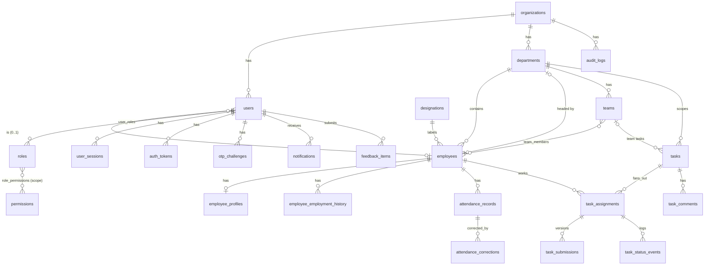

# TAD: Technical Architecture Document, BisTech EMS

Version: 1.1 | Date: 2026-11-17
Companion docs: PRD.md, SAD.md, FSD.md, FTL.md

> **What changed in 1.1** (full list in Appendix A): section 4 now defines the complete folder and file structure for the Next.js frontend, NestJS backend, shared contracts, infra, tests and CI; section 7 now contains the **finalized 28-table PostgreSQL schema** (runnable DDL); new section 17 holds all configuration files; new section 18 holds the environment-variable contract. Section numbers 1 to 16 are unchanged so references from PRD.md and FTL.md (for example "TAD.md section 12" and "section 13") stay valid.
>
> **Verification status**: the DDL in section 7 was applied to an empty PostgreSQL 16 database and spot-checked with constraint tests while drafting (cross-tenant FK, self-review, one pending submission, append-only tables, OTP limits, team-department trigger, grants). It has **not** yet run in CI or staging, and the full constraint-test suite is still an M0 exit criterion (F-002). Package versions, config snippets and the Dockerfiles are untested starting points.

---

## 1. Architecture style (ADR-001, ADR-002)

- **Modular monolith**: one NestJS API app, one worker process (same codebase), separately deployed Next.js frontend. Reason: 3 developers, strongly related data, transactional workflows. Microservices are not justified. Revisit only on ADR-001 triggers.
- **NestJS on the Express adapter** (`@nestjs/platform-express`), not Fastify (cookie, CSRF, Helmet choices are Express-based). Revisit if the team drops below two NestJS-experienced developers or a module is extracted.
- **Worker**: `worker.ts` using `NestFactory.createApplicationContext(WorkerModule)` (no HTTP server). `WorkerModule` is a second composition root over the same feature modules, without HTTP guards or the throttler. For a tiny pilot it may run inside the API process; split before a second API instance.

## 2. Technology stack

Choices marked **(final)** were open or optional in 1.0 and are now decided. Versions are pinned in M0 (F-001 compatibility spike); none are stated here on purpose.

| Layer | Choice | Notes |
|---|---|---|
| Repo | npm workspaces + Turborepo monorepo: `apps/web`, `apps/api`, `packages/contracts`, `packages/config` **(final)** | contracts = Zod schemas + TS types + permission definition shared by UI and API. npm keeps `npm audit` from SAD.md valid; pnpm would also work if the team prefers it |
| Runtime | Node.js LTS (`.nvmrc`), TypeScript strict everywhere **(final)** | One Node major for web, api, CI and Docker |
| Frontend | Next.js (App Router) + TypeScript | Presentation and forms only; client validation is usability, not security |
| UI components | shadcn/ui (Radix UI + Tailwind CSS) | Components copied into `apps/web/src/components/ui`; accessible base for WCAG 2.1 AA |
| Icons | lucide-react | Import icons individually |
| Fonts | Google Sans via `next/font` | Verify web licence; fallback DM Sans or Figtree via `next/font/google` |
| Theme | next-themes, `defaultTheme="dark"`, class strategy, shadcn CSS variables | Light theme + toggle optional later |
| Forms | react-hook-form + `@hookform/resolvers/zod` **(final)** | Uses schemas from `packages/contracts` |
| Client data | TanStack Query **(final)** | Cache, retries, 30 to 60 s notification polling. Server Components fetch initial page data through a server-only API helper that forwards cookies |
| Tables | TanStack Table inside a shadcn `DataTable` wrapper **(final)** | Server-side pagination and sort only |
| Backend | Node.js LTS, NestJS (Express), TypeScript | `main.ts` API, `worker.ts` worker |
| Validation | Zod via global `ZodValidationPipe` (e.g. nestjs-zod) | Strict objects reject unknown fields |
| Config | `@nestjs/config` with Zod schema | App refuses to boot on bad config |
| Database | PostgreSQL 15+ (dev compose uses a current major) | SQL migrations are source of truth |
| DB access | **Prisma ORM** (`@prisma/client`) with typed models, managed via `PrismaService` inside `DatabaseModule` **(final)** | Type-safe query building, migrations, and relationship navigation across all 28 domain models |
| Migrations | **Prisma Migrate** (`prisma/schema.prisma` and `prisma migrate`) alongside plain SQL custom triggers & security grants **(final)** | Managed migration workflows; custom triggers (append-only, updated_at) and roles applied via migration scripts |
| Transactions | `TransactionService` on AsyncLocalStorage (e.g. nestjs-cls) | Repositories join the active transaction automatically |
| Passwords/tokens | Argon2id (`argon2`), JWT via `jose`, opaque refresh tokens, OTP via HMAC-SHA256 | See SAD.md |
| Queue | pg-boss in `QueueModule` | Same DB and backup; no Redis. Its `pgboss` schema is installed by the migrator step, API and worker start with `migrate: false` |
| Email | Nodemailer + Gmail in `EmailModule` (worker), called by pg-boss jobs | Never inside a DB transaction. A local SMTP catcher (Mailpit) is used in dev only |
| In-process events | `@nestjs/event-emitter` | Emitted after commit |
| Rate limiting | `@nestjs/throttler` with custom key generators | In-process store at launch |
| Health | `@nestjs/terminus` | `/health` liveness only; `/ready` internal |
| Logging/errors | `nestjs-pino`, `@sentry/nestjs`, `@sentry/nextjs` | Redact tokens, OTP, passwords, personal data |
| API docs | `@nestjs/swagger` (optional) | Internal only, off in production |
| Testing | Jest + `@nestjs/testing`, Supertest, Testcontainers (PostgreSQL), Playwright + axe, k6, OWASP ZAP; Vitest + Testing Library for web and contracts | Include dark mode in axe checks |
| Code quality | ESLint (flat config) + `eslint-plugin-boundaries`, Prettier, Husky + lint-staged, commitlint (Conventional Commits), gitleaks | See section 17 |
| CI/CD | GitHub Actions | Lint, type-check, tests, dependency audit, migration check, deploy |

**Caveat**: nestjs-zod, nestjs-cls, nestjs-pino, @sentry/nestjs, and Prisma ORM are intended choices, not verified for mutual compatibility. Pin and verify versions in M0. Keep first-party `@nestjs/*` packages on one version line.

## 3. Frontend stack summary
Next.js App Router + TS; Tailwind + shadcn/ui (Radix); lucide-react; Google Sans (or fallback) via next/font; next-themes dark by default; Zod schemas from `packages/contracts`; react-hook-form; TanStack Query/Table; Playwright + axe.

Frontend rules (apply to every UI ticket):
1. Server Components by default; `'use client'` only on interactive leaves (forms, tables with state, the notification bell, theme toggle).
2. The browser talks to one origin. `next.config.ts` rewrites `/api/*` to the API (`API_INTERNAL_URL`). No CORS needed.
3. No token in `localStorage`, `sessionStorage`, URLs or JS-readable cookies. Auth cookies are HttpOnly and set by the API. The CSRF token comes from `GET /auth/me` (and login/refresh responses) and is held **in memory only** by `lib/api/csrf.ts`.
4. All HTTP goes through `lib/api/client.ts` (browser) or `lib/api/server.ts` (server, forwards the incoming cookies). Neither is bypassed with raw `fetch`. The client attaches `X-CSRF-Token`, does single-flight refresh on `TOKEN_EXPIRED`, and branches on `error.code`, never on message text.
5. Navigation and action visibility come from `GET /auth/me` permissions through `lib/auth/permissions.ts` (`can(permission, minScope?)`). The server still enforces everything.
6. A route-protection file (`middleware.ts`; named `proxy.ts` in newer Next.js majors, verify in F-007) only redirects unauthenticated visitors to `/login` and sets the CSP nonce. It is a UX convenience, not authorization.
7. Every form uses a contracts schema with `zodResolver`; server `details[].field` errors are mapped back onto fields.
8. Dark mode is the baseline; every new screen is checked with axe in dark mode.

## 4. Repository layout

### 4.1 Monorepo root

```
bistech-ems/
├── apps/
│   ├── api/                         NestJS API + worker (section 4.2)
│   └── web/                         Next.js frontend (section 4.3)
├── packages/
│   ├── contracts/                   Zod schemas, TS types, permission definition (section 4.4)
│   └── config/                      shared tsconfig, eslint and prettier presets (section 4.4)
├── tools/
│   └── eslint-rules/                custom rules: no-string-sql, no-forward-ref (section 17.1)
├── tests/
│   └── perf/                        k6 scenarios, dataset generator (section 4.5)
├── infra/                           Dockerfiles, compose, DB bootstrap, runbook sources (section 4.5)
├── docs/                            ADRs, runbooks, ERD, API notes (section 4.5)
├── .github/                         workflows, CODEOWNERS, dependabot, PR template (section 4.5)
├── .husky/                          pre-commit, commit-msg hooks
├── .zap/                            OWASP ZAP baseline rules
├── .editorconfig
├── .gitattributes
├── .gitignore
├── .gitleaks.toml
├── .npmrc
├── .nvmrc
├── .prettierignore
├── .prettierrc.json
├── commitlint.config.mjs
├── eslint.config.mjs                root flat config (boundaries, restricted syntax)
├── lint-staged.config.mjs
├── package.json                     workspaces + root scripts
├── package-lock.json
├── tsconfig.base.json
├── turbo.json
├── docker-compose.dev.yml           local PostgreSQL + Mailpit
├── README.md                        quick start, scripts, ticket workflow
├── CONTRIBUTING.md
├── SECURITY.md                      how to report a vulnerability (contact from Q15)
└── PRD.md  SAD.md  TAD.md  FSD.md  FTL.md   (or under docs/specs/)
```

### 4.2 Backend: `apps/api`

One NestJS codebase, two entry points (`main.ts` API, `worker.ts` worker). Global API prefix `api/v1`.

```
apps/api/
├── src/
│   ├── main.ts                          HTTP bootstrap: Helmet, cookie-parser, body limit, global prefix,
│   │                                    enableShutdownHooks, Swagger (non-production only)
│   ├── worker.ts                        createApplicationContext(WorkerModule), shutdown hooks
│   ├── app.module.ts                    API composition root: Config, Database, Queue (publisher only),
│   │                                    all feature modules, APP_GUARD/APP_INTERCEPTOR/APP_FILTER/APP_PIPE
│   ├── worker.module.ts                 worker composition root: Config, Database, Queue(consumer), Email,
│   │                                    modules that own job handlers, Observability
│   │
│   ├── config/
│   │   ├── config.module.ts             @nestjs/config, validated at boot, isGlobal
│   │   ├── env.schema.ts                Zod schema for every variable in section 18
│   │   ├── configuration.ts             typed, grouped config factory (http, db, auth, email, queue, sentry)
│   │   └── config.service.ts            typed accessor (AppConfigService)
│   │
│   ├── common/                          cross-cutting code, imports nothing from modules/
│   │   ├── guards/
│   │   │   ├── authentication.guard.ts  JWT verify (jose), skips @Public(), attaches RequestUser
│   │   │   ├── permissions.guard.ts     reads @RequirePermission(), loads grants from DB, checks scope level
│   │   │   ├── csrf.guard.ts            X-CSRF-Token bound to session + Origin match
│   │   │   ├── throttler.guard.ts       custom key generators (IP+email, user id, session)
│   │   │   └── guards.constants.ts      APP_GUARD registration order: throttler, csrf, authn, permissions
│   │   ├── decorators/
│   │   │   ├── public.decorator.ts              @Public()
│   │   │   ├── require-permission.decorator.ts  @RequirePermission(PermissionKey, minScope?) typed by contracts
│   │   │   ├── current-user.decorator.ts        @CurrentUser() -> RequestUser {userId, orgId, sessionId, employeeId}
│   │   │   ├── scope.decorator.ts               @Scope() -> resolved ScopeContext for the handler
│   │   │   ├── idempotent.decorator.ts          @Idempotent() marks routes that need Idempotency-Key
│   │   │   └── throttle-class.decorator.ts      @ThrottleClass('login' | 'otp' | ...)
│   │   ├── pipes/
│   │   │   └── zod-validation.pipe.ts           body, query, params; strict; maps to VALIDATION_ERROR details
│   │   ├── interceptors/
│   │   │   ├── idempotency.interceptor.ts       Idempotency-Key replay, IDEMPOTENCY_KEY_REUSED
│   │   │   ├── request-logging.interceptor.ts   route, status, duration, ids; never bodies
│   │   │   └── response-envelope.interceptor.ts { success, message, data, meta }
│   │   ├── filters/
│   │   │   └── all-exceptions.filter.ts         one global filter, error envelope + requestId
│   │   ├── middleware/
│   │   │   ├── request-id.middleware.ts         X-Request-Id in/out, ALS binding
│   │   │   ├── security-headers.middleware.ts   Helmet config (CSP for API JSON, HSTS, nosniff, referrer)
│   │   │   └── body-size.middleware.ts          1 MB limit -> 413
│   │   ├── errors/
│   │   │   ├── app.exception.ts                 base AppException(code, httpStatus, details?)
│   │   │   ├── error-codes.ts                   re-exports the code list from contracts
│   │   │   └── domain-errors.ts                 NotFound, Conflict, Forbidden, SelfReview, TeamEmpty, ...
│   │   ├── pagination/
│   │   │   ├── offset-pagination.ts             page/limit/total/totalPages
│   │   │   ├── cursor-pagination.ts             opaque (created_at, id) cursor encode/decode
│   │   │   └── sort-allow-list.ts               sort=field|-field validation helper
│   │   ├── dates/
│   │   │   ├── clock.service.ts                 injectable now(); faked in tests
│   │   │   └── org-calendar.ts                  work_date, working-day, late-minute helpers (org timezone)
│   │   ├── security/
│   │   │   ├── password.service.ts              Argon2id hash/verify/needsRehash, policy, breach check port
│   │   │   ├── token.service.ts                 JWT sign/verify (kid rotation), opaque token generate/hash
│   │   │   ├── otp.service.ts                   CSPRNG code, HMAC with key id, constant-time compare
│   │   │   ├── crypto.service.ts                AES-256-GCM for job payloads, sha256 helpers
│   │   │   ├── csrf-token.service.ts            token derive/verify bound to session id
│   │   │   ├── permission-resolver.service.ts   read-only SQL: roles -> permissions -> union of scopes
│   │   │   ├── scope-resolver.ts                own/team/department/managed/org predicates for repositories
│   │   │   └── cookies.ts                       cookie names/options (__Host- where path allows)
│   │   └── types/
│   │       ├── request-user.ts
│   │       └── express.d.ts                     Request augmentation (user, requestId)
│   │
│   ├── shared-kernel/                   tiny shared contracts that break module cycles
│   │   ├── employee-lifecycle.handler.ts        interface + EMPLOYEE_LIFECYCLE_HANDLERS multi-provider token
│   │   └── index.ts
│   │
│   ├── database/
│   │   ├── database.module.ts           PrismaService provider, global
│   │   ├── prisma.service.ts            extends PrismaClient ($connect, $disconnect)
│   │   ├── transaction.service.ts       runs interactive transactions ($transaction)
│   │   ├── errors.ts                    maps Prisma/PG error codes (P2002, P2003, etc.) to domain errors
│   │   ├── migrations/
│   │   │   ├── 0001_functions.sql
│   │   │   ├── 0002_identity.sql
│   │   │   ├── 0003_org_employees.sql
│   │   │   ├── 0004_attendance.sql
│   │   │   ├── 0005_teams_tasks.sql
│   │   │   ├── 0006_feedback_platform_audit.sql
│   │   │   ├── 0007_triggers.sql
│   │   │   ├── 0008_functions.sql
│   │   │   └── 0009_grants.sql
│   │   └── seeds/
│   │       ├── permissions.generated.sql    GENERATED from packages/contracts (32 rows)
│   │       ├── seed-system-roles.ts         seedSystemRoles(tx, orgId): 4 roles + role_permissions, idempotent
│   │       ├── seed-bootstrap.ts            first organization + first Super Admin invite
│   │       └── seed-dev-fixtures.ts         synthetic demo data (never staging/prod real data)
│   │
│   ├── queue/
│   │   ├── queue.module.ts              pg-boss (publisher in API, consumer in worker), migrate:false
│   │   ├── queue.service.ts             enqueue after commit, singleton keys, retry policy defaults
│   │   ├── job-names.ts                 constants + payload types
│   │   └── handlers/
│   │       ├── send-otp-email.handler.ts
│   │       ├── send-invite-email.handler.ts
│   │       ├── send-password-changed-email.handler.ts
│   │       └── cleanup.handler.ts       nightly retention cleanup (SAD retention table)
│   │
│   ├── email/
│   │   ├── email.module.ts
│   │   ├── email.service.ts             Nodemailer transport (Gmail OAuth2 or app password; SMTP in dev)
│   │   ├── email.provider.ts            EmailProvider port (faked in tests)
│   │   └── templates/
│   │       ├── otp.template.ts
│   │       ├── invite.template.ts
│   │       └── password-changed.template.ts
│   │
│   ├── events/
│   │   ├── event-names.ts               constants (user.invited, task.assigned, ...)
│   │   └── event-payloads.ts            typed payloads
│   │
│   ├── observability/
│   │   ├── observability.module.ts
│   │   ├── logger.config.ts             nestjs-pino config + redaction list
│   │   ├── sentry.ts                    init + beforeSend scrubbing (API and worker)
│   │   ├── metrics.service.ts           request, pool, queue metrics
│   │   └── health/
│   │       ├── health.controller.ts     GET /health -> {"status":"ok"} (Public); /ready internal
│   │       └── ready.indicator.ts       DB + queue checks
│   │
│   └── modules/
│       ├── identity/
│       ├── organization/
│       ├── employees/
│       ├── attendance/
│       ├── teams/
│       ├── tasks/
│       ├── feedback/
│       ├── notifications/
│       ├── dashboard/
│       ├── audit/
│       └── platform/                    (all expanded in 4.2.2)
│
├── test/                                (expanded in 4.2.3)
├── scripts/
│   ├── migrate.ts                       apply SQL migrations (checksum table, advisory lock)
│   ├── migrate-pgboss.ts                install/upgrade the pgboss schema as ems_migrator
│   ├── gen-permissions-sql.ts           contracts -> seeds/permissions.generated.sql
│   ├── check-permissions-sync.ts        CI: DB permissions == contracts definition
│   ├── gen-db-types.ts                  kysely-codegen wrapper
│   └── print-routes.ts                  dumps the Nest route table (used by the route scan)
├── .env.example
├── .env.test.example
├── nest-cli.json
├── package.json
├── tsconfig.json
├── tsconfig.build.json
├── jest.config.ts                       unit
├── jest.integration.config.ts           integration + API + authorization + workflow
└── eslint.config.mjs
```

#### 4.2.1 Module template

Every feature module follows this shape. Files that a module does not need are simply omitted.

```
modules/<name>/
├── index.ts                    PUBLIC facade: exports the module class, exported service(s) and public types only
├── <name>.module.ts            providers, controllers, exports (service facade only)
├── <name>.controller.ts        @RequirePermission on every handler; no business logic
├── <name>.service.ts           business rules, scope checks (404), transactions, audit writes
├── <name>.repository.ts        Database queries via PrismaService only; every function takes organizationId first; NOT exported
├── <name>.mapper.ts            row -> response DTO (explicit allow-lists); never returns entities
├── dto/                        thin re-exports of contracts schemas + createZodDto classes
├── events/
│   ├── <name>.events.ts        event payload types owned by this module
│   └── <name>.listeners.ts     @OnEvent handlers (after-commit side effects only)
├── jobs/                       job handlers owned by this module (registered only by WorkerModule)
├── <name>.service.spec.ts      unit tests live next to the code
└── <name>.repository.spec.ts   only when it has logic beyond SQL
```

Rules: other modules import only from `@/modules/<name>` (the `index.ts`); `forwardRef` is banned; repositories are never exported; a module never reads another module's tables directly (call its facade). Dashboard is the single deliberate read-only exception.

#### 4.2.2 Feature modules in full

```
modules/identity/                               owns: users, roles, permissions, role_permissions, user_roles,
│                                               user_sessions, auth_tokens, otp_challenges
├── index.ts
├── identity.module.ts
├── auth/
│   ├── auth.controller.ts                      login, refresh, logout, me, accept-invite, forgot-password,
│   │                                           verify-otp, reset-password, change-password
│   ├── auth.service.ts                         login/lockout/refresh rotation orchestration
│   ├── password-reset.service.ts               OTP + reset-token workflow (SAD section 3)
│   ├── invite.service.ts                       issue / accept / resend invite tokens
│   └── auth.mapper.ts                          /auth/me response (roles, permissions+scopes, employeeId, csrfToken)
├── sessions/
│   ├── sessions.controller.ts                  GET /auth/sessions, DELETE /auth/sessions/{id}
│   ├── sessions.service.ts                     create, rotate, reuse-detect, revoke (by user / by family)
│   └── sessions.repository.ts
├── users/
│   ├── users.controller.ts                     /users, /users/{id}, /users/{id}/roles, /users/{id}/unlock
│   ├── users.service.ts                        status changes, role replacement, last-Super-Admin guard
│   └── users.repository.ts
├── roles/
│   ├── roles.controller.ts                     GET /roles, GET /permissions
│   ├── roles.service.ts
│   └── roles.repository.ts
├── auth-tokens.repository.ts
├── otp.repository.ts
├── dto/  events/  (user.invited, role.changed, password.reset)
└── *.spec.ts

modules/organization/                           owns: organizations, departments, designations, holidays
├── index.ts, organization.module.ts
├── settings/        organization.controller.ts (GET/PATCH /organization), settings.service.ts, settings.cache.ts (60 s TTL)
├── departments/     departments.controller.ts, departments.service.ts, departments.repository.ts
│                    (head assignment PUT /departments/{id}/head lives in the service; locks the row)
├── designations/    designations.controller.ts, designations.service.ts, designations.repository.ts
├── holidays/        holidays.controller.ts, holidays.service.ts, holidays.repository.ts
└── dto/  events/ (department.head.changed)  *.spec.ts

modules/employees/                              owns: employees, employee_profiles, employee_employment_history
├── index.ts, employees.module.ts
├── employees.controller.ts                     /employees, /employees/{id}, /invite, /deactivate, /reactivate
├── profile.controller.ts                       /employees/{id}/profile, /me/profile
├── history.controller.ts                       /employees/{id}/history
├── employees.service.ts                        create (code counter under lock), update, history writes
├── onboarding.service.ts                       create-employee transaction (FSD 2.3)
├── lifecycle.service.ts                        department change, deactivate, reactivate; runs
│                                               EMPLOYEE_LIFECYCLE_HANDLERS inside the transaction
├── employees.repository.ts, profiles.repository.ts, history.repository.ts
├── employees.mapper.ts, profile.mapper.ts      work-profile vs sensitive-profile DTOs kept separate
├── jobs/deactivate-scheduled.job.ts            future-dated deactivation (conditional, idempotent)
├── dto/  events/ (employee.created, employee.department.changed, employee.deactivated)  *.spec.ts

modules/attendance/                             owns: attendance_records, attendance_corrections
├── index.ts, attendance.module.ts
├── attendance.controller.ts                    check-in, /me, list, summary, {id}, corrections
├── attendance.service.ts                       check-in (server clock), views, scope filtering
├── corrections.service.ts                      HR correction transaction (snapshot, upsert, audit)
├── absence.query.ts                            THE single derived-absence SQL definition (reused by dashboard)
├── attendance.repository.ts, corrections.repository.ts
├── dto/  events/ (attendance.corrected)  *.spec.ts

modules/teams/                                  owns: teams, team_members
├── index.ts, teams.module.ts
├── teams.controller.ts, teams.service.ts, teams.repository.ts, members.repository.ts
├── teams.lifecycle.handler.ts                  EmployeeLifecycleHandler: ends memberships
├── dto/  events/ (team.member.added)  *.spec.ts

modules/tasks/                                  owns: tasks, task_assignments, task_submissions,
│                                               task_comments, task_status_events
├── index.ts, tasks.module.ts
├── tasks.controller.ts                         /tasks, /tasks/me, /tasks/{id}, cancel
├── boards.controller.ts                        /tasks/board/team, /tasks/board/department (declared before /{id})
├── assignments.controller.ts                   /task-assignments/{id}, status, submissions
├── submissions.controller.ts                   /task-submissions, review
├── comments.controller.ts                      /tasks/{id}/comments
├── tasks.service.ts, assignments.service.ts, submissions.service.ts, reviews.service.ts, comments.service.ts
├── task-state-machine.ts                       pure transition table (unit-tested, FSD 2.8)
├── task-access.ts                              "can act on task" vs "board-only" decisions
├── tasks.repository.ts, assignments.repository.ts, submissions.repository.ts,
│   comments.repository.ts, status-events.repository.ts
├── tasks.lifecycle.handler.ts                  EmployeeLifecycleHandler: cancels assignments, notifies creators
├── dto/  events/ (task.assigned, task.submitted, task.reviewed, task.commented, task.cancelled)  *.spec.ts

modules/feedback/                               owns: feedback_items
├── index.ts, feedback.module.ts
├── feedback.controller.ts, feedback.service.ts, feedback.repository.ts
├── dto/  events/ (feedback.submitted, feedback.handled)  *.spec.ts

modules/notifications/                          owns: notifications
├── index.ts, notifications.module.ts
├── notifications.controller.ts                 list (cursor), unread-count, read, read-all
├── notifications.service.ts, notifications.repository.ts
├── notifications.listeners.ts                  @OnEvent subscribers; dedupe_key per event
├── jobs/due-soon.job.ts                        (later) nightly due-soon reminders
└── dto/  *.spec.ts

modules/dashboard/                              owns: nothing (read-only aggregates)
├── index.ts, dashboard.module.ts
├── dashboard.controller.ts                     /dashboard/me, /team, /hr, /company, /summary
├── dashboard.service.ts
├── metrics/ employee.metrics.ts, team.metrics.ts, hr.metrics.ts, company.metrics.ts   (FSD section 6)
└── *.spec.ts

modules/audit/                                  owns: audit_logs
├── index.ts, audit.module.ts
├── audit.service.ts                            write(tx-bound, entry); called INSIDE the caller's transaction
├── audit.controller.ts                         GET /audit-logs (cursor); viewer reads are audited
├── audit.repository.ts                         INSERT + SELECT only
├── audit.actions.ts                            action name constants (SAD section 8 list)
├── audit.redaction.ts                          strips sensitive values, keeps field names
└── dto/  *.spec.ts

modules/platform/                               owns: idempotency_keys
├── index.ts, platform.module.ts
├── idempotency.service.ts, idempotency.repository.ts
└── *.spec.ts
```

#### 4.2.3 Backend tests

```
apps/api/test/
├── helpers/
│   ├── create-test-app.ts          Test.createTestingModule with fake email + fake clock
│   ├── test-db.ts                  Testcontainers PostgreSQL, applies migrations, per-test transaction/schema
│   ├── fakes/                      fake-email.provider.ts, fake-clock.ts, fake-queue.ts
│   ├── auth.ts                     loginAs(role), cookie + CSRF helpers
│   └── assertions.ts               expectError(res, code), expectNoSecrets(res/logs)
├── fixtures/
│   ├── seed-fixtures.ts            two organizations, four roles, three departments with heads, varied teams
│   └── perf-dataset.ts             500 employees, 12 departments, 3 years attendance (synthetic)
├── db/                             constraint tests (F-002): cross-tenant FK, self-review, one pending,
│                                   append-only, grants, team-department trigger, OTP, composite FKs
├── authorization/
│   ├── permission-matrix.spec.ts   GENERATED from contracts: 32 permissions x 4 roles x scopes (T-15)
│   ├── route-scan.spec.ts          every route has @RequirePermission or @Public (T-14)
│   └── tenant-isolation.spec.ts    org A cannot touch org B (T-20)
├── api/                            Supertest per module: auth.e2e-spec.ts, employees.e2e-spec.ts, ...
├── workflows/                      onboarding, department change, deactivation, task lifecycle, review races
└── security/                       headers, CORS, CSRF, body limit, log redaction, response-secret scan
```

### 4.3 Frontend: `apps/web`

Next.js App Router, TypeScript, Tailwind, shadcn/ui. Route groups separate unauthenticated and authenticated layouts. Feature code lives in `src/features/<domain>`; `src/app` stays thin (routing, metadata, layout, data prefetch).

```
apps/web/
├── src/
│   ├── app/
│   │   ├── layout.tsx                      root: fonts, ThemeProvider (dark default), QueryProvider, Toaster
│   │   ├── globals.css                     Tailwind + shadcn CSS variables (light + dark tokens)
│   │   ├── not-found.tsx
│   │   ├── error.tsx                       segment error boundary (maps error.code to messages)
│   │   ├── global-error.tsx
│   │   ├── loading.tsx
│   │   ├── favicon.ico  icon.png
│   │   ├── page.tsx                        redirects to /dashboard or /login
│   │   │
│   │   ├── (auth)/                         unauthenticated layout (centered card)
│   │   │   ├── layout.tsx
│   │   │   ├── login/page.tsx
│   │   │   ├── accept-invite/page.tsx
│   │   │   ├── forgot-password/page.tsx
│   │   │   ├── verify-otp/page.tsx
│   │   │   └── reset-password/page.tsx
│   │   │
│   │   └── (app)/                          authenticated shell (sidebar, topbar, notification bell)
│   │       ├── layout.tsx                  loads /auth/me server-side, provides AuthProvider
│   │       ├── dashboard/page.tsx          role-aware dashboard (employee, team, HR, company)
│   │       ├── attendance/
│   │       │   ├── page.tsx                my attendance: check-in button + history
│   │       │   ├── team/page.tsx           Dept Head managed attendance
│   │       │   ├── manage/page.tsx         HR / Super Admin table, summaries
│   │       │   └── corrections/[id]/page.tsx   correction history for a record
│   │       ├── employees/
│   │       │   ├── page.tsx                list, search, filters
│   │       │   ├── new/page.tsx            create employee (idempotency key per form instance)
│   │       │   └── [id]/
│   │       │       ├── page.tsx            work profile
│   │       │       ├── profile/page.tsx    sensitive profile (employee.read.sensitive)
│   │       │       └── history/page.tsx
│   │       ├── teams/
│   │       │   ├── page.tsx
│   │       │   ├── new/page.tsx
│   │       │   └── [id]/page.tsx           members, board
│   │       ├── tasks/
│   │       │   ├── page.tsx                task list (scope-aware)
│   │       │   ├── me/page.tsx             my assignments
│   │       │   ├── new/page.tsx            self / individual / team
│   │       │   ├── board/page.tsx          team and department boards (read-only)
│   │       │   ├── review/page.tsx         review queue
│   │       │   ├── assignments/[id]/page.tsx   status, submit, review result
│   │       │   └── [id]/page.tsx           detail, progress, comments
│   │       ├── feedback/
│   │       │   ├── page.tsx                my items / triage list
│   │       │   ├── new/page.tsx
│   │       │   └── [id]/page.tsx
│   │       ├── organization/
│   │       │   ├── settings/page.tsx
│   │       │   ├── departments/page.tsx
│   │       │   ├── designations/page.tsx
│   │       │   └── holidays/page.tsx
│   │       ├── admin/
│   │       │   ├── users/page.tsx          users + role assignment
│   │       │   └── audit-logs/page.tsx
│   │       └── account/
│   │           ├── profile/page.tsx        /me/profile
│   │           └── security/page.tsx       change password, sessions
│   │
│   ├── components/
│   │   ├── ui/                             shadcn primitives (button, input, form, dialog, table, select,
│   │   │                                   dropdown-menu, sheet, tabs, toast/sonner, badge, skeleton, ...)
│   │   ├── layout/                         app-shell.tsx, sidebar.tsx, topbar.tsx, page-header.tsx,
│   │   │                                   user-menu.tsx, theme-toggle.tsx
│   │   ├── data-table/                     data-table.tsx, pagination.tsx, column-header.tsx, toolbar.tsx
│   │   ├── forms/                          form-field.tsx, form-error-summary.tsx, submit-button.tsx,
│   │   │                                   password-input.tsx, date-picker.tsx, confirm-dialog.tsx
│   │   └── feedback/                       empty-state.tsx, error-state.tsx, status-badge.tsx, spinner.tsx
│   │
│   ├── features/                           one folder per domain; mirrors backend modules
│   │   ├── auth/            api.ts, hooks.ts, components/ (login-form, otp-form, reset-form, sessions-list), schemas.ts
│   │   ├── users/           api.ts, hooks.ts, components/ (users-table, role-editor)
│   │   ├── organization/    api.ts, hooks.ts, components/ (settings-form, departments, designations, holidays)
│   │   ├── employees/       api.ts, hooks.ts, components/ (employee-form, employee-table, profile-card,
│   │   │                    history-timeline, department-change-dialog, deactivate-dialog)
│   │   ├── attendance/      api.ts, hooks.ts, components/ (check-in-card, attendance-table, correction-form,
│   │   │                    summary-chart)
│   │   ├── teams/           api.ts, hooks.ts, components/ (team-form, members-editor)
│   │   ├── tasks/           api.ts, hooks.ts, components/ (task-form, task-card, board, submission-form,
│   │   │                    review-panel, comment-thread, status-timeline)
│   │   ├── feedback/        api.ts, hooks.ts, components/ (feedback-form, triage-panel)
│   │   ├── notifications/   api.ts, hooks.ts (30 to 60 s polling), components/ (bell, notification-list)
│   │   ├── dashboard/       api.ts, hooks.ts, components/ (stat-card, employee/team/hr/company dashboards)
│   │   └── audit/           api.ts, hooks.ts, components/ (audit-table, filters)
│   │
│   ├── lib/
│   │   ├── api/
│   │   │   ├── client.ts                   browser client: credentials, CSRF header, single-flight refresh
│   │   │   ├── server.ts                   server-only client: forwards cookies to API_INTERNAL_URL
│   │   │   ├── csrf.ts                     in-memory CSRF token holder
│   │   │   ├── errors.ts                   ApiError(code, status, details, requestId); code -> UI message map
│   │   │   └── idempotency.ts              newIdempotencyKey() per form instance
│   │   ├── auth/
│   │   │   ├── permissions.ts              can(permission, minScope?) over the /auth/me payload
│   │   │   └── session.ts                  getSession() for Server Components
│   │   ├── query/                          query-client.ts, query-keys.ts
│   │   ├── dates.ts                        formatting in org timezone (Asia/Dhaka default)
│   │   ├── utils.ts                        cn() and small pure helpers
│   │   └── env.ts                          Zod-validated NEXT_PUBLIC_* and server env
│   │
│   ├── providers/                          theme-provider.tsx, query-provider.tsx, auth-provider.tsx
│   ├── hooks/                              use-debounce.ts, use-media-query.ts, use-permission.ts
│   ├── config/                             nav.ts (items with required permission), site.ts, fonts.ts
│   └── middleware.ts                       redirect to /login without session cookie; CSP nonce
│
├── public/                                 static assets (logo, og image), robots.txt
├── e2e/                                    Playwright: auth.spec.ts, onboarding.spec.ts, attendance.spec.ts,
│   │                                       tasks.spec.ts, feedback.spec.ts, a11y.spec.ts (axe, dark mode)
│   ├── fixtures/                           storage states per role, seeded users
│   └── playwright.config.ts
├── tests/                                  Vitest + Testing Library component and util tests
│   └── setup.ts
├── components.json                         shadcn CLI config
├── next.config.ts
├── postcss.config.mjs
├── vitest.config.ts
├── tsconfig.json
├── eslint.config.mjs
├── package.json
├── .env.example
└── sentry.client.config.ts  sentry.server.config.ts  instrumentation.ts
```

Tailwind: with the current CSS-first Tailwind, theme tokens live in `globals.css` and no `tailwind.config.ts` is needed. If the team stays on Tailwind 3, add `tailwind.config.ts` (class dark mode, shadcn colors) next to `postcss.config.mjs`. Decide in F-007.

### 4.4 Shared packages

```
packages/contracts/                         the single source of truth shared by UI and API
├── src/
│   ├── index.ts
│   ├── permissions/
│   │   ├── definition.ts                   32 permissions, 4 roles, scope per role (FSD section 1) as data
│   │   ├── keys.ts                         PermissionKey union derived from definition
│   │   ├── scopes.ts                       Scope type + ordering (own < team < department < managed < org)
│   │   └── matrix.ts                       effective-access resolver used by the test generator and UI
│   ├── enums.ts                            all vocabularies (FSD section 7), one const array each
│   ├── errors.ts                           error codes (FSD section 3) + HTTP mapping
│   ├── envelope.ts                         success / error / pagination envelope schemas
│   ├── common.ts                           uuid, isoDate, email, e164 phone, pagination query, sort schema
│   ├── auth.schema.ts
│   ├── users.schema.ts
│   ├── organization.schema.ts
│   ├── employees.schema.ts
│   ├── attendance.schema.ts
│   ├── teams.schema.ts
│   ├── tasks.schema.ts
│   ├── feedback.schema.ts
│   ├── notifications.schema.ts
│   ├── dashboard.schema.ts
│   └── audit.schema.ts
├── test/                                   Vitest: schema accept/reject cases, matrix snapshot
├── package.json                            exports: dual ESM + CJS, types
├── tsconfig.json
└── tsup.config.ts

packages/config/                            shared presets (no runtime code)
├── tsconfig/ base.json  nest.json  next.json  library.json
├── eslint/   base.mjs  nest.mjs  next.mjs
└── prettier/ index.json
```

### 4.5 Infra, docs, CI, performance

```
infra/
├── docker/
│   ├── Dockerfile.api                      multi-stage; one image runs main.js or worker.js
│   ├── Dockerfile.web                      Next.js standalone output (VPS deploys; Vercel needs none)
│   └── .dockerignore
├── compose/
│   ├── docker-compose.staging.yml          reference for a VPS: api, worker, web, reverse proxy
│   └── caddy/Caddyfile                     or nginx.conf: TLS, HSTS, /api proxy, edge rate limits
├── db/
│   ├── bootstrap-roles.sql                 ems_migrator, ems_app, database, schema privileges, role timeouts
│   └── init-dev.sh                         dev compose init: creates roles and database
└── scripts/
    ├── deploy.sh                           migrate -> start worker -> start api -> smoke test
    └── smoke-test.sh                       /health, login probe on staging

docs/
├── adr/            0001-modular-monolith.md  0002-nestjs-express.md  0003-kysely-and-sql-migrations.md
├── runbooks/       deploy.md  rollback.md  restore-drill.md  on-call.md  incident-and-breach.md  gmail-sending.md
├── erd/            ems-erd.mmd  ems-erd.svg  (regenerated from final DDL, section 7.8)
├── security/       asvs-l2-review.md  checklist-S01-S39.md
└── perf/           results-<commit>.md

.github/
├── workflows/
│   ├── ci.yml                              PR: install, lint, typecheck, boundaries, tests, audit, secrets, build
│   ├── migration-check.yml                 empty DB -> apply all -> constraint tests -> types in sync
│   ├── e2e-nightly.yml                     Playwright + axe (dark mode), nightly and pre-release
│   ├── security.yml                        ZAP baseline against staging (manual / pre-release)
│   ├── deploy-staging.yml                  build images, migrate, deploy
│   └── deploy-production.yml               manual approval, migrate, deploy, smoke test
├── CODEOWNERS
├── dependabot.yml
└── pull_request_template.md                ticket id, permission declared, tests, audit, EXPLAIN checked

tests/perf/
├── k6/             checkin-burst.js  browse.js  search.js  summaries.js  boards.js  dashboards.js
│                   login-otp-burst.js  team-task-50.js  lib/auth.js
└── dataset/        generate.ts (500 employees, 12 departments, 3 y attendance, ~180k assignments, synthetic)
```

### 4.6 Naming and structure conventions

| Item | Convention |
|---|---|
| Files and folders | kebab-case with a role suffix: `tasks.service.ts`, `task-state-machine.ts`, `create-task.schema.ts` |
| Classes / types | PascalCase; Zod schemas camelCase ending in `Schema` (`createTaskSchema`), inferred types PascalCase (`CreateTaskInput`) |
| React components | PascalCase exports in kebab-case files (`check-in-card.tsx` exports `CheckInCard`) |
| Database | snake_case plural tables, snake_case columns; JSON over the wire is camelCase, mapped in `*.mapper.ts` |
| Imports | `@/` alias to `src/` inside an app; `@ems/contracts` for shared code; no `../../..` chains; barrel files only at a module's `index.ts` |
| Tests | `*.spec.ts` next to the unit; integration, API, authorization and workflow tests under `apps/api/test`; Playwright under `apps/web/e2e` |
| Commits / branches | Conventional Commits (`feat(tasks): ...`), branch `F-041-task-creation`; one ticket per PR |
| Generated files | `db.types.ts`, `permissions.generated.sql`, ERD: committed, marked generated, CI fails if stale |

## 5. Modules and ownership

Each module owns its tables and exposes only a service facade through `exports` and its `index.ts`. Repositories, internal services and DTOs are not exported. Dashboard is the one deliberate exception (read-only aggregate queries). No `forwardRef` anywhere.

| Module | Owns tables | Calls (exported services of) | Events published |
|---|---|---|---|
| Identity | users, roles, permissions, role_permissions, user_roles, user_sessions, auth_tokens, otp_challenges | Employees (link on invite) | user.invited, role.changed, password.reset |
| Organization | organizations, departments, designations, holidays | none | department.head.changed |
| Employees | employees, employee_profiles, employee_employment_history | Organization, Identity | employee.created, employee.department.changed, employee.deactivated |
| Attendance | attendance_records, attendance_corrections | Employees, Organization | attendance.corrected |
| Teams | teams, team_members | Employees, Organization | team.member.added |
| Tasks | tasks, task_assignments, task_submissions, task_comments, task_status_events | Employees, Teams | task.assigned, task.submitted, task.reviewed, task.commented, task.cancelled |
| Feedback | feedback_items | Identity | feedback.submitted, feedback.handled |
| Notifications | notifications | Identity | none |
| Dashboard | none | read-only on all | none |
| Audit | audit_logs | none | none |
| Platform (global) | idempotency_keys | none | none |

Cross-module rules:
- Events are in-process, emitted after commit. Notifications and Audit subscribe with `@OnEvent`. The audit row itself is written by the service **inside the same transaction** (not by an event).
- Direct service calls where the caller needs the result inside its transaction (e.g. deactivation cancelling assignments).
- **Cycle avoidance**: Employees must call Tasks/Teams on department change and deactivation, while those read Employees. Solve with an `EmployeeLifecycleHandler` interface in `src/shared-kernel`. Tasks and Teams register handlers via a multi-provider token (`EMPLOYEE_LIFECYCLE_HANDLERS`); Employees runs all handlers inside its transaction.
- `common/security/permission-resolver.service.ts` runs read-only SQL over `roles`, `permissions`, `role_permissions` and `user_roles` for the global guard. This is the second deliberate read-only exception (the guard sits in `common`, which may not import Identity). Nothing in it writes.
- A lint rule (`eslint-plugin-boundaries` entry-point rule plus import restrictions, section 17.1) fails CI on imports of another module's internals.

## 6. Request pipeline (fixed order)

1. **Middleware**: request id + structured log start, Helmet, body size limit (1 MB), strict CORS allow-list, cookie parsing.
2. **Guards** (global via `APP_GUARD`): throttler, CSRF (token + Origin on state-changing requests), authentication (JWT signature/issuer/audience/expiry; skipped for `@Public()`), permissions (reads `@RequirePermission()`, loads permissions from DB, checks permission + scope level).
3. **Interceptors (before)**: idempotency (`Idempotency-Key`), request logging.
4. **Pipe**: global `ZodValidationPipe` for body, query, params; unknown fields rejected.
5. **Controller -> service**: service resolves record-level scope (own/team/department/managed/org), returns 404 for out-of-scope, opens transactions, writes audit.
6. **Interceptor (after)**: success envelope.
7. **Exception filter**: one global filter, standard error envelope, internals logged not returned.

Fail-closed: a route with neither `@RequirePermission()` nor `@Public()` is denied. A CI test (`test/authorization/route-scan.spec.ts`, fed by `scripts/print-routes.ts`) scans the route table and fails the build.

## 7. Database architecture (finalized schema)

- PostgreSQL 15+, **28 tables**, one schema (`public`), `organization_id` on every tenant table with composite FKs `(organization_id, x_id)` to `(organization_id, id)`.
- UUID PKs (`gen_random_uuid()`, built in since PostgreSQL 13, no extension needed); `employee_code` (e.g. BST-00123) is a separate business key, formatted by the app from `employee_code_prefix` + `last_employee_number` padded to 5 digits.
- `TIMESTAMPTZ` UTC for instants; `DATE` for joining date, due date, holiday date, `work_date` (org timezone).
- snake_case plural tables; camelCase in JSON.
- No hard delete of employees, attendance, tasks, submissions, audit. The app role physically lacks `DELETE` on them (7.2).
- Append-only (trigger + grants): `audit_logs`, `task_status_events`, and also `employee_employment_history`, `attendance_corrections`, `task_comments` (FSD calls these append-only or immutable).
- Migrations: plain SQL files, separate deploy step before the new version starts, backward compatible, run over a direct connection as `ems_migrator`. Never on app start.
- Generic `updated_at` trigger on every table that has the column.
- Row-Level Security is deferred (SAD section 4); tenant isolation is composite FKs + required `organizationId` repository arguments.

### 7.1 Tables (28)

| Area | Tables |
|---|---|
| Identity and access (9) | organizations (tenant root), users, roles, permissions, role_permissions, user_roles, user_sessions, auth_tokens, otp_challenges |
| Organization and people (6) | departments, designations, holidays, employees, employee_profiles, employee_employment_history |
| Attendance (2) | attendance_records, attendance_corrections |
| Teams and tasks (7) | teams, team_members, tasks, task_assignments, task_submissions, task_comments, task_status_events |
| Feedback and platform (4) | feedback_items, notifications, audit_logs, idempotency_keys |

9 + 6 + 2 + 7 + 4 = 28.

### 7.2 Database roles and privileges

| Role | Purpose | Rights |
|---|---|---|
| admin / superuser | one-time bootstrap per environment | runs `infra/db/bootstrap-roles.sql` |
| `ems_migrator` | owns the schema and objects; used only by the migration step (`scripts/migrate.ts`, `scripts/migrate-pgboss.ts`) | DDL; never used by API or worker |
| `ems_app` | runtime role for API and worker | no DDL; `SELECT/INSERT/UPDATE` on business tables; **`INSERT + SELECT` only** on the five append-only tables; `DELETE` only on `user_sessions`, `auth_tokens`, `otp_challenges`, `notifications`, `idempotency_keys` (cleanup jobs), `user_roles` (role replacement) and `holidays` (FSD `DELETE /holidays/{id}`); `SELECT` only on `permissions`; role-level `statement_timeout = 10s` and `idle_in_transaction_session_timeout = 30s` |

`ems_app` also needs `USAGE` and DML on the `pgboss` schema, granted by `migrate-pgboss.ts` after it installs pg-boss as `ems_migrator`. API and worker start pg-boss with `migrate: false`.

Role-level settings (`ALTER ROLE ... SET`) live in the bootstrap script, not in migrations, because a migration role cannot alter another role without `ADMIN` on it (found while testing the DDL).

### 7.3 Migration files

Applied in order by `scripts/migrate.ts` (records filename + SHA-256 in `schema_migrations`, takes a `pg_advisory_lock`, refuses to run a changed already-applied file). Future changes are new numbered files, written expand-then-contract so the previous app version keeps working during deploy.

| File | Contents |
|---|---|
| `0001_functions.sql` | `set_updated_at()`, `block_mutation()` |
| `0002_identity.sql` | organizations, users, roles, permissions, role_permissions, user_roles, user_sessions, auth_tokens, otp_challenges |
| `0003_org_employees.sql` | departments, designations, holidays, employees, `departments.head_employee_id` FK, employee_profiles, employee_employment_history |
| `0004_attendance.sql` | attendance_records, attendance_corrections |
| `0005_teams_tasks.sql` | teams, team_members (+ department trigger), tasks, task_assignments, task_submissions, task_comments, task_status_events |
| `0006_feedback_platform_audit.sql` | feedback_items, notifications, audit_logs, idempotency_keys |
| `0007_triggers.sql` | `updated_at` triggers; append-only triggers |
| `0008_functions.sql` | `managed_employee_ids()` |
| `0009_grants.sql` | least-privilege grants for `ems_app` |

### 7.4 Final DDL

#### infra/db/bootstrap-roles.sql (run once per environment, as admin)
```sql
-- infra/db/bootstrap-roles.sql : run once per environment as a superuser/admin
CREATE ROLE ems_migrator LOGIN PASSWORD :'migrator_password';
CREATE ROLE ems_app      LOGIN PASSWORD :'app_password' NOSUPERUSER NOCREATEDB NOCREATEROLE;
CREATE DATABASE ems OWNER ems_migrator;
\connect ems
REVOKE ALL ON DATABASE ems FROM PUBLIC;
GRANT CONNECT ON DATABASE ems TO ems_app;
REVOKE CREATE ON SCHEMA public FROM PUBLIC;
ALTER ROLE ems_app SET statement_timeout = '10s';
ALTER ROLE ems_app SET idle_in_transaction_session_timeout = '30s';
```

#### apps/api/src/database/migrations/0001_functions.sql
```sql
-- 0001_functions.sql : shared trigger functions

CREATE FUNCTION set_updated_at() RETURNS trigger
LANGUAGE plpgsql AS $$
BEGIN
  NEW.updated_at := now();
  RETURN NEW;
END $$;

CREATE FUNCTION block_mutation() RETURNS trigger
LANGUAGE plpgsql AS $$
BEGIN
  RAISE EXCEPTION '% on % is not allowed: table is append-only', TG_OP, TG_TABLE_NAME
    USING ERRCODE = '42501';
END $$;
```

#### apps/api/src/database/migrations/0002_identity.sql
```sql
-- 0002_identity.sql : tenant root, users, RBAC, sessions, tokens, OTP

CREATE TABLE organizations (
  id                   uuid PRIMARY KEY DEFAULT gen_random_uuid(),
  name                 text NOT NULL CHECK (char_length(name) BETWEEN 1 AND 150),
  slug                 text NOT NULL CHECK (slug ~ '^[a-z0-9]+(-[a-z0-9]+)*$'),
  timezone             text NOT NULL DEFAULT 'Asia/Dhaka',
  settings             jsonb NOT NULL DEFAULT
    '{"workStart":"10:00","graceMinutes":15,"workEnd":"18:30","weekendDays":[5,6]}'::jsonb
    CHECK (jsonb_typeof(settings) = 'object'),            -- weekendDays: ISO (1=Mon..7=Sun)
  employee_code_prefix text NOT NULL DEFAULT 'BST' CHECK (employee_code_prefix ~ '^[A-Z]{2,6}$'),
  last_employee_number integer NOT NULL DEFAULT 0 CHECK (last_employee_number >= 0),
  created_at           timestamptz NOT NULL DEFAULT now(),
  updated_at           timestamptz NOT NULL DEFAULT now(),
  CONSTRAINT organizations_slug_key UNIQUE (slug)
);

CREATE TABLE users (
  id                 uuid PRIMARY KEY DEFAULT gen_random_uuid(),
  organization_id    uuid NOT NULL REFERENCES organizations (id),
  email              text NOT NULL CHECK (char_length(email) BETWEEN 3 AND 254),
  display_name       text NOT NULL CHECK (char_length(display_name) BETWEEN 1 AND 160),
  password_hash      text,
  account_status     text NOT NULL DEFAULT 'invited'
    CHECK (account_status IN ('invited','active','suspended','disabled')),
  failed_login_count integer NOT NULL DEFAULT 0 CHECK (failed_login_count >= 0),
  locked_until       timestamptz,
  last_login_at      timestamptz,
  password_changed_at timestamptz,
  created_at         timestamptz NOT NULL DEFAULT now(),
  updated_at         timestamptz NOT NULL DEFAULT now(),
  CONSTRAINT users_org_id_key UNIQUE (organization_id, id),
  CONSTRAINT users_active_requires_hash CHECK (account_status <> 'active' OR password_hash IS NOT NULL)
);
CREATE UNIQUE INDEX users_org_email_key ON users (organization_id, lower(email));

CREATE TABLE roles (
  id              uuid PRIMARY KEY DEFAULT gen_random_uuid(),
  organization_id uuid NOT NULL REFERENCES organizations (id),
  name            text NOT NULL CHECK (char_length(name) BETWEEN 1 AND 60),
  description     text,
  is_system       boolean NOT NULL DEFAULT false,
  created_at      timestamptz NOT NULL DEFAULT now(),
  updated_at      timestamptz NOT NULL DEFAULT now(),
  CONSTRAINT roles_org_id_key UNIQUE (organization_id, id),
  CONSTRAINT roles_org_name_key UNIQUE (organization_id, name)
);

CREATE TABLE permissions (
  id          uuid PRIMARY KEY DEFAULT gen_random_uuid(),
  key         text NOT NULL CHECK (key ~ '^[a-z]+(\.[a-z]+)+$'),
  description text NOT NULL,
  CONSTRAINT permissions_key_key UNIQUE (key)
);

CREATE TABLE role_permissions (
  role_id       uuid NOT NULL REFERENCES roles (id),
  permission_id uuid NOT NULL REFERENCES permissions (id),
  scope         text NOT NULL CHECK (scope IN ('own','team','department','managed','org')),
  PRIMARY KEY (role_id, permission_id)
);
CREATE INDEX role_permissions_permission_idx ON role_permissions (permission_id);

CREATE TABLE user_roles (
  user_id         uuid NOT NULL,
  role_id         uuid NOT NULL,
  organization_id uuid NOT NULL,
  assigned_by     uuid,
  assigned_at     timestamptz NOT NULL DEFAULT now(),
  PRIMARY KEY (user_id, role_id),
  CONSTRAINT user_roles_user_fk     FOREIGN KEY (organization_id, user_id)     REFERENCES users (organization_id, id),
  CONSTRAINT user_roles_role_fk     FOREIGN KEY (organization_id, role_id)     REFERENCES roles (organization_id, id),
  CONSTRAINT user_roles_assigner_fk FOREIGN KEY (organization_id, assigned_by) REFERENCES users (organization_id, id)
);
CREATE INDEX user_roles_role_idx ON user_roles (organization_id, role_id);

-- One row per refresh token. A rotation inserts a new row in the same family and sets rotated_at on the old one.
-- family_id is the session id exposed to the API and carried in the access-token (sid).
CREATE TABLE user_sessions (
  id                  uuid PRIMARY KEY DEFAULT gen_random_uuid(),
  organization_id     uuid NOT NULL,
  user_id             uuid NOT NULL,
  family_id           uuid NOT NULL,
  refresh_token_hash  text NOT NULL,
  user_agent          text CHECK (char_length(user_agent) <= 512),
  ip_address          inet,
  created_at          timestamptz NOT NULL DEFAULT now(),
  last_used_at        timestamptz NOT NULL DEFAULT now(),
  rotated_at          timestamptz,
  expires_at          timestamptz NOT NULL,            -- idle expiry (12 h), slides on rotation
  absolute_expires_at timestamptz NOT NULL,            -- 7 d from login, never extended
  revoked_at          timestamptz,
  revoked_reason      text CHECK (revoked_reason IN ('logout','password_change','password_reset',
                        'account_disabled','deactivated','role_removed','reuse_detected','user_revoke','admin_revoke')),
  CONSTRAINT user_sessions_hash_key UNIQUE (refresh_token_hash),
  CONSTRAINT user_sessions_user_fk FOREIGN KEY (organization_id, user_id) REFERENCES users (organization_id, id),
  CONSTRAINT user_sessions_expiry_chk CHECK (expires_at <= absolute_expires_at),
  CONSTRAINT user_sessions_revoke_chk CHECK ((revoked_at IS NULL) = (revoked_reason IS NULL))
);
CREATE INDEX user_sessions_family_idx ON user_sessions (family_id);
CREATE INDEX user_sessions_user_live_idx ON user_sessions (user_id)
  WHERE revoked_at IS NULL AND rotated_at IS NULL;
CREATE INDEX user_sessions_cleanup_idx ON user_sessions (absolute_expires_at);

CREATE TABLE auth_tokens (
  id              uuid PRIMARY KEY DEFAULT gen_random_uuid(),
  organization_id uuid NOT NULL,
  user_id         uuid NOT NULL,
  purpose         text NOT NULL CHECK (purpose IN ('invite','password_reset')),
  token_hash      text NOT NULL,
  expires_at      timestamptz NOT NULL,
  used_at         timestamptz,
  created_at      timestamptz NOT NULL DEFAULT now(),
  CONSTRAINT auth_tokens_hash_key UNIQUE (token_hash),
  CONSTRAINT auth_tokens_user_fk FOREIGN KEY (organization_id, user_id) REFERENCES users (organization_id, id)
);
CREATE INDEX auth_tokens_user_purpose_idx ON auth_tokens (user_id, purpose) WHERE used_at IS NULL;
CREATE INDEX auth_tokens_cleanup_idx ON auth_tokens (expires_at);

CREATE TABLE otp_challenges (
  id              uuid PRIMARY KEY DEFAULT gen_random_uuid(),
  organization_id uuid NOT NULL,
  user_id         uuid NOT NULL,
  purpose         text NOT NULL CHECK (purpose IN ('password_reset')),
  code_hash       text NOT NULL,                       -- HMAC-SHA256(challengeId:code), never a plain hash
  hmac_key_id     text NOT NULL,                       -- which HMAC secret version produced it (rotation grace)
  attempts        smallint NOT NULL DEFAULT 0,
  max_attempts    smallint NOT NULL DEFAULT 5,
  sent_at         timestamptz NOT NULL DEFAULT now(),
  expires_at      timestamptz NOT NULL,
  consumed_at     timestamptz,
  created_at      timestamptz NOT NULL DEFAULT now(),
  CONSTRAINT otp_attempts_chk CHECK (attempts >= 0 AND attempts <= max_attempts),
  CONSTRAINT otp_max_attempts_chk CHECK (max_attempts BETWEEN 1 AND 5),
  CONSTRAINT otp_user_fk FOREIGN KEY (organization_id, user_id) REFERENCES users (organization_id, id)
);
CREATE UNIQUE INDEX otp_one_live_per_user_purpose ON otp_challenges (user_id, purpose) WHERE consumed_at IS NULL;
CREATE INDEX otp_rate_idx ON otp_challenges (user_id, created_at DESC);
CREATE INDEX otp_cleanup_idx ON otp_challenges (expires_at);
```

#### apps/api/src/database/migrations/0003_org_employees.sql
```sql
-- 0003_org_employees.sql : organization structure, employees, history

CREATE TABLE departments (
  id               uuid PRIMARY KEY DEFAULT gen_random_uuid(),
  organization_id  uuid NOT NULL REFERENCES organizations (id),
  name             text NOT NULL CHECK (char_length(name) BETWEEN 2 AND 100),
  description      text CHECK (char_length(description) <= 500),
  head_employee_id uuid,                               -- FK added after employees exists
  archived_at      timestamptz,
  created_at       timestamptz NOT NULL DEFAULT now(),
  updated_at       timestamptz NOT NULL DEFAULT now(),
  CONSTRAINT departments_org_id_key UNIQUE (organization_id, id),
  CONSTRAINT departments_org_name_key UNIQUE (organization_id, name)
);
CREATE INDEX departments_head_idx ON departments (organization_id, head_employee_id)
  WHERE head_employee_id IS NOT NULL;

CREATE TABLE designations (
  id              uuid PRIMARY KEY DEFAULT gen_random_uuid(),
  organization_id uuid NOT NULL REFERENCES organizations (id),
  title           text NOT NULL CHECK (char_length(title) BETWEEN 2 AND 100),
  archived_at     timestamptz,
  created_at      timestamptz NOT NULL DEFAULT now(),
  updated_at      timestamptz NOT NULL DEFAULT now(),
  CONSTRAINT designations_org_id_key UNIQUE (organization_id, id),
  CONSTRAINT designations_org_title_key UNIQUE (organization_id, title)
);

CREATE TABLE holidays (
  id              uuid PRIMARY KEY DEFAULT gen_random_uuid(),
  organization_id uuid NOT NULL REFERENCES organizations (id),
  holiday_date    date NOT NULL,
  name            text NOT NULL CHECK (char_length(name) BETWEEN 1 AND 100),
  created_at      timestamptz NOT NULL DEFAULT now(),
  CONSTRAINT holidays_org_date_key UNIQUE (organization_id, holiday_date)
);

CREATE TABLE employees (
  id                uuid PRIMARY KEY DEFAULT gen_random_uuid(),
  organization_id   uuid NOT NULL REFERENCES organizations (id),
  user_id           uuid NOT NULL,
  employee_code     text NOT NULL CHECK (employee_code ~ '^[A-Z]{2,6}-[0-9]{5,}$'),
  first_name        text NOT NULL CHECK (char_length(first_name) BETWEEN 1 AND 80),
  last_name         text NOT NULL CHECK (char_length(last_name) BETWEEN 1 AND 80),
  work_email        text NOT NULL CHECK (char_length(work_email) BETWEEN 3 AND 254),
  phone             text CHECK (phone ~ '^\+[1-9][0-9]{6,14}$'),
  department_id     uuid NOT NULL,
  designation_id    uuid NOT NULL,
  employment_type   text NOT NULL CHECK (employment_type IN ('full_time','part_time','contract','intern')),
  employment_status text NOT NULL DEFAULT 'active' CHECK (employment_status IN ('active','inactive')),
  joining_date      date NOT NULL,
  exit_date         date,
  created_at        timestamptz NOT NULL DEFAULT now(),
  updated_at        timestamptz NOT NULL DEFAULT now(),
  CONSTRAINT employees_org_id_key UNIQUE (organization_id, id),
  CONSTRAINT employees_user_key UNIQUE (user_id),
  CONSTRAINT employees_user_fk        FOREIGN KEY (organization_id, user_id)        REFERENCES users (organization_id, id),
  CONSTRAINT employees_department_fk  FOREIGN KEY (organization_id, department_id)  REFERENCES departments (organization_id, id),
  CONSTRAINT employees_designation_fk FOREIGN KEY (organization_id, designation_id) REFERENCES designations (organization_id, id),
  CONSTRAINT employees_exit_chk CHECK (exit_date IS NULL OR exit_date >= joining_date),
  CONSTRAINT employees_inactive_requires_exit CHECK (employment_status = 'active' OR exit_date IS NOT NULL)
);
CREATE UNIQUE INDEX employees_org_code_key  ON employees (organization_id, employee_code);
CREATE UNIQUE INDEX employees_org_email_key ON employees (organization_id, lower(work_email));
CREATE INDEX employees_org_status_idx      ON employees (organization_id, employment_status);
CREATE INDEX employees_org_dept_status_idx ON employees (organization_id, department_id, employment_status);
CREATE INDEX employees_org_name_idx        ON employees (organization_id, lower(last_name), lower(first_name));

ALTER TABLE departments
  ADD CONSTRAINT departments_head_fk
  FOREIGN KEY (organization_id, head_employee_id) REFERENCES employees (organization_id, id);

CREATE TABLE employee_profiles (
  employee_id               uuid PRIMARY KEY,
  organization_id           uuid NOT NULL,
  date_of_birth             date CHECK (date_of_birth < CURRENT_DATE),
  personal_email            text CHECK (char_length(personal_email) <= 254),
  personal_phone            text CHECK (personal_phone ~ '^\+[1-9][0-9]{6,14}$'),
  address_line              text CHECK (char_length(address_line) <= 300),
  city                      text CHECK (char_length(city) <= 100),
  country_code              char(2) CHECK (country_code ~ '^[A-Z]{2}$'),
  emergency_contact_name    text CHECK (char_length(emergency_contact_name) <= 120),
  emergency_contact_phone   text CHECK (emergency_contact_phone ~ '^\+[1-9][0-9]{6,14}$'),
  emergency_contact_relation text CHECK (char_length(emergency_contact_relation) <= 60),
  created_at                timestamptz NOT NULL DEFAULT now(),
  updated_at                timestamptz NOT NULL DEFAULT now(),
  CONSTRAINT employee_profiles_employee_fk FOREIGN KEY (organization_id, employee_id)
    REFERENCES employees (organization_id, id)
);

CREATE TABLE employee_employment_history (
  id              uuid PRIMARY KEY DEFAULT gen_random_uuid(),
  organization_id uuid NOT NULL,
  employee_id     uuid NOT NULL,
  event_type      text NOT NULL CHECK (event_type IN
                    ('hired','department_change','designation_change','status_change','reactivated')),
  effective_date  date NOT NULL,
  old_value       jsonb,
  new_value       jsonb,
  reason          text CHECK (char_length(reason) <= 500),
  changed_by      uuid NOT NULL,
  created_at      timestamptz NOT NULL DEFAULT now(),
  CONSTRAINT history_employee_fk   FOREIGN KEY (organization_id, employee_id) REFERENCES employees (organization_id, id),
  CONSTRAINT history_changed_by_fk FOREIGN KEY (organization_id, changed_by)  REFERENCES users (organization_id, id)
);
CREATE INDEX history_employee_idx ON employee_employment_history (employee_id, effective_date DESC, created_at DESC);
```

#### apps/api/src/database/migrations/0004_attendance.sql
```sql
-- 0004_attendance.sql : check-in only attendance (A5, A14)

CREATE TABLE attendance_records (
  id              uuid PRIMARY KEY DEFAULT gen_random_uuid(),
  organization_id uuid NOT NULL,
  employee_id     uuid NOT NULL,
  work_date       date NOT NULL,                        -- calendar day in the organization's timezone
  check_in_at     timestamptz,
  status          text NOT NULL CHECK (status IN ('present','late','absent')),
  source          text NOT NULL CHECK (source IN ('web','hr_correction')),
  late_minutes    integer NOT NULL DEFAULT 0 CHECK (late_minutes >= 0),
  note            text CHECK (char_length(note) <= 200),
  created_at      timestamptz NOT NULL DEFAULT now(),
  updated_at      timestamptz NOT NULL DEFAULT now(),
  CONSTRAINT attendance_org_id_key UNIQUE (organization_id, id),
  CONSTRAINT attendance_employee_day_key UNIQUE (employee_id, work_date),
  CONSTRAINT attendance_employee_fk FOREIGN KEY (organization_id, employee_id) REFERENCES employees (organization_id, id),
  CONSTRAINT attendance_checkin_required CHECK (status = 'absent' OR check_in_at IS NOT NULL),
  CONSTRAINT attendance_absent_shape CHECK (status <> 'absent' OR (late_minutes = 0 AND source = 'hr_correction')),
  CONSTRAINT attendance_late_shape CHECK (status = 'late' OR late_minutes = 0)
);
CREATE INDEX attendance_org_date_status_idx ON attendance_records (organization_id, work_date, status);

CREATE TABLE attendance_corrections (
  id                    uuid PRIMARY KEY DEFAULT gen_random_uuid(),
  organization_id       uuid NOT NULL,
  employee_id           uuid NOT NULL,
  attendance_record_id  uuid,                           -- null when the day had no row
  work_date             date NOT NULL,
  corrected_check_in_at timestamptz,
  corrected_status      text NOT NULL CHECK (corrected_status IN ('present','late','absent')),
  reason                text NOT NULL CHECK (char_length(reason) BETWEEN 10 AND 500),
  original_snapshot     jsonb,                          -- null when there was no original row
  corrected_by          uuid NOT NULL,
  created_at            timestamptz NOT NULL DEFAULT now(),
  CONSTRAINT corrections_employee_fk FOREIGN KEY (organization_id, employee_id) REFERENCES employees (organization_id, id),
  CONSTRAINT corrections_record_fk   FOREIGN KEY (organization_id, attendance_record_id) REFERENCES attendance_records (organization_id, id),
  CONSTRAINT corrections_user_fk     FOREIGN KEY (organization_id, corrected_by) REFERENCES users (organization_id, id),
  CONSTRAINT corrections_checkin_chk CHECK (corrected_status = 'absent' OR corrected_check_in_at IS NOT NULL)
);
CREATE INDEX corrections_record_idx ON attendance_corrections (attendance_record_id, created_at DESC);
CREATE INDEX corrections_employee_day_idx ON attendance_corrections (employee_id, work_date);
```

#### apps/api/src/database/migrations/0005_teams_tasks.sql
```sql
-- 0005_teams_tasks.sql : teams, tasks, assignments, submissions, comments, status events

CREATE TABLE teams (
  id              uuid PRIMARY KEY DEFAULT gen_random_uuid(),
  organization_id uuid NOT NULL,
  department_id   uuid NOT NULL,
  name            text NOT NULL CHECK (char_length(name) BETWEEN 2 AND 80),
  description     text CHECK (char_length(description) <= 500),
  created_by      uuid NOT NULL,
  archived_at     timestamptz,
  created_at      timestamptz NOT NULL DEFAULT now(),
  updated_at      timestamptz NOT NULL DEFAULT now(),
  CONSTRAINT teams_org_id_key UNIQUE (organization_id, id),
  CONSTRAINT teams_department_fk FOREIGN KEY (organization_id, department_id) REFERENCES departments (organization_id, id),
  CONSTRAINT teams_created_by_fk FOREIGN KEY (organization_id, created_by)    REFERENCES users (organization_id, id)
);
CREATE UNIQUE INDEX teams_dept_name_active_key ON teams (department_id, lower(name)) WHERE archived_at IS NULL;
CREATE INDEX teams_org_dept_idx ON teams (organization_id, department_id) WHERE archived_at IS NULL;

CREATE TABLE team_members (
  id              uuid PRIMARY KEY DEFAULT gen_random_uuid(),
  organization_id uuid NOT NULL,
  team_id         uuid NOT NULL,
  employee_id     uuid NOT NULL,
  added_by        uuid NOT NULL,
  added_at        timestamptz NOT NULL DEFAULT now(),
  removed_at      timestamptz,
  CONSTRAINT team_members_team_fk     FOREIGN KEY (organization_id, team_id)     REFERENCES teams (organization_id, id),
  CONSTRAINT team_members_employee_fk FOREIGN KEY (organization_id, employee_id) REFERENCES employees (organization_id, id),
  CONSTRAINT team_members_added_by_fk FOREIGN KEY (organization_id, added_by)    REFERENCES users (organization_id, id),
  CONSTRAINT team_members_removed_chk CHECK (removed_at IS NULL OR removed_at >= added_at)
);
CREATE UNIQUE INDEX team_members_active_key ON team_members (team_id, employee_id) WHERE removed_at IS NULL;
CREATE INDEX team_members_employee_active_idx ON team_members (employee_id) WHERE removed_at IS NULL;

CREATE FUNCTION team_members_check_department() RETURNS trigger
LANGUAGE plpgsql AS $$
DECLARE
  emp_dept  uuid;
  team_dept uuid;
BEGIN
  SELECT department_id INTO emp_dept  FROM employees WHERE organization_id = NEW.organization_id AND id = NEW.employee_id;
  SELECT department_id INTO team_dept FROM teams     WHERE organization_id = NEW.organization_id AND id = NEW.team_id;
  IF emp_dept IS DISTINCT FROM team_dept THEN
    RAISE EXCEPTION 'employee % is not in the department of team %', NEW.employee_id, NEW.team_id
      USING ERRCODE = '23514';
  END IF;
  RETURN NEW;
END $$;
CREATE TRIGGER team_members_department_chk BEFORE INSERT ON team_members
  FOR EACH ROW EXECUTE FUNCTION team_members_check_department();

CREATE TABLE tasks (
  id              uuid PRIMARY KEY DEFAULT gen_random_uuid(),
  organization_id uuid NOT NULL,
  title           text NOT NULL CHECK (char_length(title) BETWEEN 1 AND 150),
  description     text CHECK (char_length(description) <= 4000),
  priority        text NOT NULL DEFAULT 'medium' CHECK (priority IN ('low','medium','high','urgent')),
  due_date        date,
  assignment_type text NOT NULL CHECK (assignment_type IN ('self','individual','team')),
  team_id         uuid,
  department_id   uuid NOT NULL,                        -- fixed at creation (FSD 2.7)
  requires_review boolean NOT NULL,
  status          text NOT NULL DEFAULT 'active' CHECK (status IN ('active','cancelled')),
  created_by      uuid NOT NULL,
  cancelled_at    timestamptz,
  cancel_reason   text CHECK (char_length(cancel_reason) <= 500),
  created_at      timestamptz NOT NULL DEFAULT now(),
  updated_at      timestamptz NOT NULL DEFAULT now(),
  CONSTRAINT tasks_org_id_key UNIQUE (organization_id, id),
  CONSTRAINT tasks_team_fk       FOREIGN KEY (organization_id, team_id)       REFERENCES teams (organization_id, id),
  CONSTRAINT tasks_department_fk FOREIGN KEY (organization_id, department_id) REFERENCES departments (organization_id, id),
  CONSTRAINT tasks_created_by_fk FOREIGN KEY (organization_id, created_by)    REFERENCES users (organization_id, id),
  CONSTRAINT tasks_team_iff_team_type CHECK ((assignment_type = 'team') = (team_id IS NOT NULL)),
  CONSTRAINT tasks_cancel_shape CHECK ((status = 'cancelled') = (cancelled_at IS NOT NULL))
);
CREATE INDEX tasks_org_dept_status_due_idx ON tasks (organization_id, department_id, status, due_date);
CREATE INDEX tasks_team_idx       ON tasks (team_id) WHERE team_id IS NOT NULL;
CREATE INDEX tasks_created_by_idx ON tasks (created_by);

CREATE TABLE task_assignments (
  id              uuid PRIMARY KEY DEFAULT gen_random_uuid(),
  organization_id uuid NOT NULL,
  task_id         uuid NOT NULL,
  employee_id     uuid NOT NULL,
  status          text NOT NULL DEFAULT 'todo' CHECK (status IN
                    ('todo','in_progress','in_review','changes_requested','done','cancelled')),
  started_at      timestamptz,
  submitted_at    timestamptz,
  completed_at    timestamptz,
  created_at      timestamptz NOT NULL DEFAULT now(),
  updated_at      timestamptz NOT NULL DEFAULT now(),
  CONSTRAINT task_assignments_org_id_key UNIQUE (organization_id, id),
  CONSTRAINT task_assignments_task_employee_key UNIQUE (task_id, employee_id),
  CONSTRAINT task_assignments_task_fk     FOREIGN KEY (organization_id, task_id)     REFERENCES tasks (organization_id, id),
  CONSTRAINT task_assignments_employee_fk FOREIGN KEY (organization_id, employee_id) REFERENCES employees (organization_id, id),
  CONSTRAINT task_assignments_completed_chk CHECK (status = 'done' OR completed_at IS NULL)
);
CREATE INDEX task_assignments_employee_status_idx ON task_assignments (employee_id, status);
CREATE INDEX task_assignments_task_idx ON task_assignments (task_id);

CREATE TABLE task_submissions (
  id              uuid PRIMARY KEY DEFAULT gen_random_uuid(),
  organization_id uuid NOT NULL,
  assignment_id   uuid NOT NULL,
  version         integer NOT NULL CHECK (version >= 1),
  note            text NOT NULL CHECK (char_length(note) BETWEEN 1 AND 2000),
  links           jsonb NOT NULL DEFAULT '[]'::jsonb
                  CHECK (jsonb_typeof(links) = 'array' AND jsonb_array_length(links) <= 5),
  submitted_by    uuid NOT NULL,
  submitted_at    timestamptz NOT NULL DEFAULT now(),
  review_status   text NOT NULL DEFAULT 'pending'
                  CHECK (review_status IN ('pending','approved','changes_requested','not_required')),
  reviewed_by     uuid,
  reviewed_at     timestamptz,
  review_note     text CHECK (char_length(review_note) <= 500),
  CONSTRAINT task_submissions_assignment_fk FOREIGN KEY (organization_id, assignment_id) REFERENCES task_assignments (organization_id, id),
  CONSTRAINT task_submissions_submitter_fk  FOREIGN KEY (organization_id, submitted_by)  REFERENCES users (organization_id, id),
  CONSTRAINT task_submissions_reviewer_fk   FOREIGN KEY (organization_id, reviewed_by)   REFERENCES users (organization_id, id),
  CONSTRAINT task_submissions_version_key UNIQUE (assignment_id, version),
  CONSTRAINT task_submissions_no_self_review CHECK (reviewed_by <> submitted_by),
  CONSTRAINT task_submissions_review_shape CHECK (
    (review_status IN ('approved','changes_requested')) = (reviewed_by IS NOT NULL AND reviewed_at IS NOT NULL)),
  CONSTRAINT task_submissions_changes_need_note CHECK (review_status <> 'changes_requested' OR review_note IS NOT NULL)
);
CREATE UNIQUE INDEX task_submissions_one_pending_key ON task_submissions (assignment_id) WHERE review_status = 'pending';
CREATE INDEX task_submissions_review_queue_idx ON task_submissions (organization_id, submitted_at) WHERE review_status = 'pending';

CREATE TABLE task_comments (
  id              uuid PRIMARY KEY DEFAULT gen_random_uuid(),
  organization_id uuid NOT NULL,
  task_id         uuid NOT NULL,
  author_user_id  uuid NOT NULL,
  body            text NOT NULL CHECK (char_length(body) BETWEEN 1 AND 2000),
  created_at      timestamptz NOT NULL DEFAULT now(),
  CONSTRAINT task_comments_task_fk   FOREIGN KEY (organization_id, task_id)        REFERENCES tasks (organization_id, id),
  CONSTRAINT task_comments_author_fk FOREIGN KEY (organization_id, author_user_id) REFERENCES users (organization_id, id)
);
CREATE INDEX task_comments_thread_idx ON task_comments (task_id, created_at, id);

CREATE TABLE task_status_events (
  id              uuid PRIMARY KEY DEFAULT gen_random_uuid(),
  organization_id uuid NOT NULL,
  assignment_id   uuid NOT NULL,
  from_status     text CHECK (from_status IN ('todo','in_progress','in_review','changes_requested','done','cancelled')),
  to_status       text NOT NULL CHECK (to_status IN ('todo','in_progress','in_review','changes_requested','done','cancelled')),
  actor_user_id   uuid,                                 -- null for system-driven cancellation by job
  created_at      timestamptz NOT NULL DEFAULT now(),
  CONSTRAINT task_events_assignment_fk FOREIGN KEY (organization_id, assignment_id) REFERENCES task_assignments (organization_id, id),
  CONSTRAINT task_events_actor_fk      FOREIGN KEY (organization_id, actor_user_id) REFERENCES users (organization_id, id)
);
CREATE INDEX task_events_assignment_idx ON task_status_events (assignment_id, created_at, id);
```

#### apps/api/src/database/migrations/0006_feedback_platform_audit.sql
```sql
-- 0006_feedback_platform_audit.sql

CREATE TABLE feedback_items (
  id              uuid PRIMARY KEY DEFAULT gen_random_uuid(),
  organization_id uuid NOT NULL,
  submitted_by    uuid NOT NULL,
  kind            text NOT NULL CHECK (kind IN ('issue','suggestion')),
  category        text NOT NULL CHECK (category IN ('general','attendance','tasks','system','workplace','other')),
  subject         text NOT NULL CHECK (char_length(subject) BETWEEN 5 AND 150),
  body            text NOT NULL CHECK (char_length(body) BETWEEN 10 AND 4000),
  status          text NOT NULL DEFAULT 'open' CHECK (status IN ('open','in_review','resolved','closed')),
  resolution_note text CHECK (char_length(resolution_note) <= 2000),
  handled_by      uuid,
  handled_at      timestamptz,
  created_at      timestamptz NOT NULL DEFAULT now(),
  updated_at      timestamptz NOT NULL DEFAULT now(),
  CONSTRAINT feedback_submitter_fk FOREIGN KEY (organization_id, submitted_by) REFERENCES users (organization_id, id),
  CONSTRAINT feedback_handler_fk   FOREIGN KEY (organization_id, handled_by)   REFERENCES users (organization_id, id),
  CONSTRAINT feedback_handled_shape CHECK (status = 'open' OR (handled_by IS NOT NULL AND handled_at IS NOT NULL))
);
CREATE INDEX feedback_org_status_created_idx ON feedback_items (organization_id, status, created_at DESC);
CREATE INDEX feedback_submitter_idx ON feedback_items (submitted_by, created_at DESC);

CREATE TABLE notifications (
  id              uuid PRIMARY KEY DEFAULT gen_random_uuid(),
  organization_id uuid NOT NULL,
  user_id         uuid NOT NULL,
  type            text NOT NULL CHECK (char_length(type) BETWEEN 1 AND 60),
  title           text NOT NULL CHECK (char_length(title) <= 150),
  body            text CHECK (char_length(body) <= 500),
  payload         jsonb NOT NULL DEFAULT '{}'::jsonb,   -- deep-link ids only
  dedupe_key      text NOT NULL CHECK (char_length(dedupe_key) <= 200),
  read_at         timestamptz,
  created_at      timestamptz NOT NULL DEFAULT now(),
  CONSTRAINT notifications_user_fk FOREIGN KEY (organization_id, user_id) REFERENCES users (organization_id, id),
  CONSTRAINT notifications_dedupe_key UNIQUE (user_id, dedupe_key)
);
CREATE INDEX notifications_user_created_idx ON notifications (user_id, created_at DESC, id DESC);
CREATE INDEX notifications_user_unread_idx  ON notifications (user_id, created_at DESC) WHERE read_at IS NULL;
CREATE INDEX notifications_cleanup_idx      ON notifications (read_at) WHERE read_at IS NOT NULL;

CREATE TABLE audit_logs (
  id              uuid PRIMARY KEY DEFAULT gen_random_uuid(),
  organization_id uuid NOT NULL REFERENCES organizations (id),
  actor_user_id   uuid,                                 -- null for unauthenticated events (failed login, OTP)
  action          text NOT NULL CHECK (char_length(action) BETWEEN 1 AND 80),
  entity_type     text NOT NULL CHECK (char_length(entity_type) BETWEEN 1 AND 60),
  entity_id       uuid,                                 -- deliberate polymorphic reference, no FK
  metadata        jsonb NOT NULL DEFAULT '{}'::jsonb,   -- changed fields; never secrets or personal values
  ip_address      inet,
  user_agent      text CHECK (char_length(user_agent) <= 512),
  request_id      text,
  created_at      timestamptz NOT NULL DEFAULT now(),
  CONSTRAINT audit_actor_fk FOREIGN KEY (organization_id, actor_user_id) REFERENCES users (organization_id, id)
);
CREATE INDEX audit_org_created_idx ON audit_logs (organization_id, created_at DESC, id DESC);
CREATE INDEX audit_entity_idx ON audit_logs (organization_id, entity_type, entity_id, created_at DESC);

CREATE TABLE idempotency_keys (
  organization_id uuid NOT NULL,
  user_id         uuid NOT NULL,
  key             uuid NOT NULL,
  request_hash    text NOT NULL,                        -- sha256(method + path + canonical body)
  response_status integer,                              -- null while the first request is in flight
  response_body   jsonb,
  created_at      timestamptz NOT NULL DEFAULT now(),
  expires_at      timestamptz NOT NULL,                 -- replay window 24 h
  PRIMARY KEY (organization_id, user_id, key),
  CONSTRAINT idempotency_user_fk FOREIGN KEY (organization_id, user_id) REFERENCES users (organization_id, id)
);
CREATE INDEX idempotency_cleanup_idx ON idempotency_keys (created_at);
```

#### apps/api/src/database/migrations/0007_triggers.sql
```sql
-- 0007_triggers.sql : updated_at maintenance and append-only enforcement

DO $$
DECLARE t text;
BEGIN
  FOREACH t IN ARRAY ARRAY[
    'organizations','users','roles','departments','designations','employees','employee_profiles',
    'attendance_records','teams','tasks','task_assignments','feedback_items'
  ] LOOP
    EXECUTE format(
      'CREATE TRIGGER %I BEFORE UPDATE ON %I FOR EACH ROW EXECUTE FUNCTION set_updated_at()',
      t || '_set_updated_at', t);
  END LOOP;

  -- Append-only tables: block UPDATE/DELETE per row and TRUNCATE per statement.
  FOREACH t IN ARRAY ARRAY[
    'audit_logs','task_status_events','employee_employment_history','attendance_corrections','task_comments'
  ] LOOP
    EXECUTE format(
      'CREATE TRIGGER %I BEFORE UPDATE OR DELETE ON %I FOR EACH ROW EXECUTE FUNCTION block_mutation()',
      t || '_append_only_row', t);
    EXECUTE format(
      'CREATE TRIGGER %I BEFORE TRUNCATE ON %I FOR EACH STATEMENT EXECUTE FUNCTION block_mutation()',
      t || '_append_only_truncate', t);
  END LOOP;
END $$;
```

#### apps/api/src/database/migrations/0008_functions.sql
```sql
-- 0008_functions.sql : managed scope

-- Employees of every department that p_head_employee_id heads (the head is included when they sit in it).
-- Callers UNION their own employee id for the "managed" scope (FSD section 1).
CREATE FUNCTION managed_employee_ids(p_org uuid, p_head_employee_id uuid)
RETURNS SETOF uuid
LANGUAGE sql STABLE AS $$
  SELECT e.id
  FROM departments d
  JOIN employees e
    ON e.organization_id = d.organization_id AND e.department_id = d.id
  WHERE d.organization_id = p_org
    AND d.head_employee_id = p_head_employee_id
$$;
```

#### apps/api/src/database/migrations/0009_grants.sql
```sql
-- 0009_grants.sql : least-privilege grants for the runtime role.
-- Roles themselves are created by infra/db/bootstrap-roles.sql (superuser), not by migrations.
--   ems_migrator : owns the schema, runs migrations, no login from the app
--   ems_app      : runtime role used by API and worker, no DDL

REVOKE ALL ON ALL TABLES IN SCHEMA public FROM PUBLIC;
GRANT USAGE ON SCHEMA public TO ems_app;

-- Read/write tables (no hard delete)
GRANT SELECT, INSERT, UPDATE ON
  organizations, users, roles, role_permissions, departments, designations, employees,
  employee_profiles, attendance_records, teams, team_members, tasks, task_assignments,
  task_submissions, feedback_items
TO ems_app;

-- Append-only tables: INSERT + SELECT only (triggers are the second line of defence)
GRANT SELECT, INSERT ON
  audit_logs, task_status_events, employee_employment_history, attendance_corrections, task_comments
TO ems_app;

-- Short-lived or configuration tables that the application may delete from
GRANT SELECT, INSERT, UPDATE, DELETE ON
  user_sessions, auth_tokens, otp_challenges, notifications, idempotency_keys
TO ems_app;
GRANT SELECT, INSERT, DELETE ON user_roles, holidays TO ems_app;

-- Global catalogue: read only (changed by migrations or the seed role)
GRANT SELECT ON permissions TO ems_app;

GRANT EXECUTE ON FUNCTION managed_employee_ids(uuid, uuid) TO ems_app;
```

### 7.5 Schema decisions and differences from the FSD data dictionary

The FSD section 8 dictionary lists key columns only. Finalizing the DDL required these decisions. Items marked **FSD update** change a vocabulary or rule and must be mirrored in FSD.md before coding starts (FTL rule 1: FSD wins on conflict, so raise it, do not silently diverge).

| # | Decision | Reason |
|---|---|---|
| 1 | `organization_id` added to every tenant table that lacked it in the dictionary: `user_sessions`, `auth_tokens`, `employee_profiles`, `employee_employment_history`, `attendance_records`, `attendance_corrections`, `task_*` tables | The architecture rule is "every tenant table"; needed for composite FKs and for org-scoped cleanup and queries |
| 2 | `user_sessions`: added `rotated_at`, `absolute_expires_at`, `last_used_at`, `revoked_reason`; `expires_at` is the sliding 12 h idle expiry; **`family_id` is the session id** exposed in the API and the JWT `sid` | One row per refresh token supports reuse detection; the session list shows rows where `rotated_at IS NULL AND revoked_at IS NULL` |
| 3 | `otp_challenges.hmac_key_id` added | SAD: HMAC secret is rotated with a grace period for live challenges; the row must say which secret verifies it |
| 4 | `users.password_changed_at` added | Supports "password changed" notice, token invalidation checks and audit |
| 5 | `employees.user_id` is `NOT NULL` | Onboarding creates the user in the same transaction; Super Admin without an employee profile is a `users` row with no employees row (PRD Q10) |
| 6 | **FSD update**: `task_submissions.review_status` gains `not_required` | FSD 2.8 sends a submission straight to `done` when review is off. Without a value, such a submission would sit as `pending` (polluting the review queue and the one-pending index) or need a fake reviewer. `not_required` keeps `reviewed_by` empty and the queue clean. Alternative if rejected: do not create a submission row for no-review tasks, but then the note and links are lost |
| 7 | `task_submissions`: reviewer and time are required exactly when status is `approved` or `changes_requested`; `changes_requested` requires `review_note` | FSD "non-pending status requires reviewer and time", "note required for changes_requested" |
| 8 | `tasks.cancel_reason` added; `task_status_events.from_status` and `actor_user_id` nullable | Cancel requires a reason (FSD 3 endpoint table); first event has no from-status; deactivation cancellation by job has no actor |
| 9 | `attendance_records.note` added; shape checks: absent only via `hr_correction` and without a check-in time; non-absent requires `check_in_at`; `late_minutes > 0` only for `late` | FSD check-in has an optional note (max 200); enforces A14 in the database |
| 10 | Append-only triggers and INSERT+SELECT grants also on `employee_employment_history`, `attendance_corrections`, `task_comments` | Dictionary marks them append-only or immutable; cheap to enforce |
| 11 | `audit_logs.actor_user_id` nullable | Failed login for an unknown email and OTP requests have no actor |
| 12 | `idempotency_keys`: PK `(organization_id, user_id, key)`, `response_status` nullable while the first request is in flight; `request_hash` covers method + path + canonical body; replay window 24 h (`expires_at`), physical cleanup after 7 d (SAD retention) | Lets the interceptor detect an in-flight duplicate and reuse of a key on another endpoint |
| 13 | `seed_system_roles` is a **TypeScript function** (`seeds/seed-system-roles.ts`), not a SQL function; the 32 `permissions` rows come from a generated SQL file | The definition lives in `packages/contracts`; SQL cannot import it. FTL F-002 acceptance (32 permissions, 4 roles) is unchanged. `scripts/check-permissions-sync.ts` fails CI if DB and contracts differ |
| 14 | `departments.head_employee_id` FK is added after `employees` is created | Circular reference between departments and employees |
| 15 | Organization settings defaults follow PRD A6: start 10:00, grace 15, end 18:30, weekend Fri and Sat stored as ISO weekdays `[5,6]` | FTL F-020 says 09:00 and 17:00; PRD wins as the intent document. **Raise in review** and align F-020 |
| 16 | Password length is 12 to 128 everywhere | SAD section 2 password table says "08 to 32", which contradicts SAD S-02, FSD section 5 and FTL F-014. Treated as a typo; fix SAD.md |

### 7.6 Indexes

All FSD section 9 indexes exist in the DDL above. Confirm with `EXPLAIN (ANALYZE, BUFFERS)` before adding more. Added or adjusted:

| Index | Reason |
|---|---|
| `user_sessions (user_id) WHERE revoked_at IS NULL AND rotated_at IS NULL`, `(family_id)`, `(absolute_expires_at)` | Session list, family revocation, cleanup |
| `auth_tokens (user_id, purpose) WHERE used_at IS NULL`, `(expires_at)` | Invalidate earlier tokens, cleanup |
| `otp_challenges (user_id, created_at DESC)` | Hourly and cooldown rate checks (3/h, 60 s) |
| `departments (organization_id, head_employee_id) WHERE head_employee_id IS NOT NULL` | `managed_employee_ids()` and head lookups |
| `teams (organization_id, department_id) WHERE archived_at IS NULL` | Team lists per department |
| `tasks (team_id) WHERE team_id IS NOT NULL` | Team board (medium priority) |
| `notifications (user_id, created_at DESC, id DESC)` plus partial unread | Cursor pagination needs a tie-breaker |
| `audit_logs (organization_id, created_at DESC, id DESC)` | Cursor pagination tie-breaker |
| `feedback_items (submitted_by, created_at DESC)` | "My items" list |
| `idempotency_keys (created_at)` | Cleanup |

`ILIKE '%x%'` is not served; add `pg_trgm` only if search is slow at real volume.

### 7.7 Seed data

- **Permissions**: `permissions.generated.sql` (32 rows) is generated by `scripts/gen-permissions-sql.ts` from `packages/contracts/src/permissions/definition.ts` and applied by the migration runner after `0009`.
- **System roles**: `seedSystemRoles(tx, organizationId)` upserts the 4 roles (`is_system = true`) and each role's own `role_permissions` grants (Employee carries every "own" grant; roles are additive).
- **Bootstrap**: `seed-bootstrap.ts` creates the first organization (BisTech, slug, Asia/Dhaka), runs `seedSystemRoles`, and creates the first Super Admin as an invited user with an invite token printed once to the operator console (never logged by the app).
- **Dev fixtures**: `seed-dev-fixtures.ts` (synthetic only) for local use and tests. Staging and development never hold real employee data (S-25).
- `managed_employee_ids(org, head_employee_id)` is in migration `0008`; callers `UNION` the caller's own employee id for the `managed` scope. Team scope reads `team_members WHERE removed_at IS NULL`.

### 7.8 Relationships (text source for the ERD)

Regenerate `docs/erd/ems-erd.svg` from this and the final DDL. Every arrow below is a composite `(organization_id, id)` foreign key except `organizations` links and the global `permissions` link.



### 7.9 Rules the database enforces (constraint tests for F-002)

Each row needs an automated test in `apps/api/test/db/`. The "Run" column records what was exercised against PostgreSQL 16 while drafting this document (ad hoc SQL, not yet the committed suite).

| Rule | Mechanism | Run |
|---|---|---|
| Cross-tenant reference rejected | Composite FKs | yes |
| Unique work email and user email per org (case-insensitive), unique employee code | Unique indexes on `(organization_id, lower(...))` | yes |
| Active user requires a password hash | CHECK | yes |
| One attendance row per employee per day | `UNIQUE (employee_id, work_date)` | yes |
| Absent only by HR correction; non-absent needs a check-in time | CHECKs | yes |
| Team member belongs to the team's department | Trigger on `team_members` | yes |
| One active membership per team and employee | Partial unique index | yes |
| Team task has a team, others do not | CHECK | yes |
| One assignment per employee per task | `UNIQUE (task_id, employee_id)` | yes |
| One pending submission per assignment | Partial unique index | yes |
| Reviewer is never the submitter | CHECK | yes |
| Reviewed status requires reviewer and time; at most 5 links | CHECKs | yes |
| One live OTP per user and purpose; attempts capped | Partial unique + CHECK | yes |
| Duplicate notifications impossible | `UNIQUE (user_id, dedupe_key)` | yes |
| `updated_at` always moves | Trigger | yes |
| `managed_employee_ids()` returns the headed department's employees | SQL function | yes |
| `ems_app` cannot UPDATE/DELETE/TRUNCATE the append-only tables; trigger blocks them even for a superuser | Grants + triggers | yes |
| `ems_app` has no DDL and cannot delete employees | Grants | yes |
| Inactive employee requires `exit_date >= joining_date` | CHECK | not yet |
| Department head must be an employee of the same organization | Composite FK | not yet |
| Cancelled task has `cancelled_at` | CHECK | not yet |
| Migration runner rejects an edited, already-applied file | Checksum | not yet |

Rules enforced only in the service layer (and tested there): head-of-department checks, scope checks, self-modification bans, state-transition validity, the last Super Admin rule, "reviewer must be in the task's review scope".

M0 exit (F-002) requires: all migrations apply to an empty database, all rows above have a committed passing test, seed creates exactly 32 permissions and 4 system roles, and `db.types.ts` and the ERD are regenerated from the final DDL.

## 8. Transactions
`TransactionService.run(async () => {...})` per workflow. Repositories use the active connection automatically (Prisma transaction client resolved from AsyncLocalStorage / PrismaService). No network call (email) while a transaction is open. `TransactionService` is the only place that checks out a connection for a unit of work. Concurrency controls per workflow are in FSD.md section 10 and mirrored by the constraints in section 7.

## 9. Background jobs (pg-boss)
Default: up to 5 attempts, exponential backoff from 30 s, failed state raises alert, idempotent handlers, singleton keys. Handlers are registered only by `WorkerModule`; the API only enqueues, and only after commit.

| Job | Trigger | Duplicate guard | Handler file |
|---|---|---|---|
| Send OTP email | after commit of challenge | singleton key per challenge id; payload code encrypted AES-256-GCM, deleted on completion, never logged; higher-priority queue | `queue/handlers/send-otp-email.handler.ts` |
| Send invite / password-changed email | after commit | singleton key per token/event id | `send-invite-email.handler.ts`, `send-password-changed-email.handler.ts` |
| Scheduled deactivation | effective date | conditional update on user status | `modules/employees/jobs/deactivate-scheduled.job.ts` |
| Cleanup (sessions, tokens, OTP, idempotency keys, notifications) | nightly | delete by age (SAD retention table) | `queue/handlers/cleanup.handler.ts` |
| Due-soon reminders | nightly (later) | `dedupe_key = task-due:{assignmentId}:{date}` | `modules/notifications/jobs/due-soon.job.ts` |

No job writes attendance rows.

## 10. Email (Nodemailer + Gmail)
- Lives in `EmailModule` in the worker; invoked only from pg-boss handlers.
- Gmail needs an **app password** (2-step verification) or, preferred for production, **OAuth2** via Nodemailer's Gmail transport. A plain password will not work. Credentials in the secret manager; never logged. The transport is chosen by `EMAIL_TRANSPORT` (section 18): `gmail_oauth2`, `gmail_app_password`, or `smtp` (Mailpit, development and CI only; refused when `NODE_ENV=production`).
- Gmail daily send caps (about 500 recipients/day on a personal account, higher on Workspace; check current limits) can be hit by bulk invites. pg-boss retry/backoff handles rejections.
- SPF/DKIM/DMARC mitigation (K5) applies only when sending from your own domain via Google Workspace. A `@gmail.com` sender is more likely to land in spam. Settle with Q9.

## 11. Infrastructure and hosting
- Frontend: Vercel for testing; VPS for commercial use (check hosting terms before production). On a VPS the web app runs from `infra/docker/Dockerfile.web` (Next.js standalone output).
- Backend and worker: persistent Node container with private networking (`node dist/main.js`, `node dist/worker.js`) from one image (`infra/docker/Dockerfile.api`). No serverless.
- Database: managed PostgreSQL, daily base backups + WAL archiving (RPO 15 min, RTO 4 h).
- Edge: CDN/WAF for TLS and DDoS; web app proxies `/api/*` so the browser sees one origin; API global prefix `api/v1`.
- Deploy order: build images -> run `scripts/migrate.ts` and `scripts/migrate-pgboss.ts` as `ems_migrator` on a direct connection -> start the new worker -> start the new API -> smoke test (`infra/scripts/smoke-test.sh`). Migrations are backward compatible with the previous app version so rollback is an image swap.
- Object storage: none. Cache: none at launch (optional in-process cache, 60 s TTL, for settings/holidays/designations).
- Pooling: 10 to 20 connections per API instance, 5 for worker, under ~70% of `max_connections`.
- Environments: development, staging, production, each with its own DB and secrets (host secret manager). Variables are listed in section 18.
- `app.enableShutdownHooks()` for graceful shutdown (30 s drain).
- Trust zones: (1) browsers, (2) edge/Next.js host, (3) API + worker (holds DB creds, signing keys, OTP HMAC secret, email creds), (4) PostgreSQL, private only.

## 12. Performance and scaling

Load estimate (arithmetic from A2, to be replaced by measurements): ~0.6 req/s check-in average, ~6 req/s at 10x burst; ~130k attendance rows/yr max; ~60k task_assignments/yr (guess); largest single write is a 50-member team task.

| Technique | Now | Add only when measured |
|---|---|---|
| Pagination | default 20, max 100; offset for admin lists, cursor for notifications/comments/audit | cursor for attendance/tasks if deep pages breach p95 |
| Indexing | High-priority indexes (FSD.md section 9, section 7.6 here) | Medium ones and pg_trgm after EXPLAIN |
| Queries | no N+1, aggregates for dashboards, absence derived in SQL (`attendance/absence.query.ts`) | materialized views |
| Caching | none for per-user/sensitive data | Redis if p95 breach or 2+ instances |
| Rate limiting | in-process throttler | shared store before 2nd instance |
| Scaling | stateless API, 1 to 2 instances | add instances at CPU > 60% or p95 breach |
| Replica/partitioning | none | dashboards replica; partition audit/notifications/events by month at tens of millions of rows |

Scaling order: fix queries/indexes, resize, second API instance (needs shared rate-limit store), read replica for dashboards, partition/archive, module extraction only on ADR-001 triggers.

Pass criteria: p95 < 500 ms list/detail; check-in p95 < 300 ms at burst; no 5xx; error rate < 1%; DB connections < 70% of limit; jobs drain in minutes; OTP emails queued within 2 min. Timeouts: API statement 10 s (enforced by the `ems_app` role setting), request 30 s.

## 13. Observability and alerts
- Logs: JSON via nestjs-pino with request id, user id, org id, route, status, duration; no bodies.
- Errors: Sentry for API, worker, web; scrub personal data.
- Metrics: request rate, p50/p95/p99, error rate per route, DB pool, slow queries, queue depth/age, CPU/mem/disk.
- Alerts: 5xx > 2% for 5 min; p95 > 500 ms for 10 min; DB connections/storage > 80%; WAL lag > 10 min; oldest job > 15 min; OTP email waiting > 2 min; job out of attempts; backup failure or last backup > 26 h; security alerts in SAD.md.

## 14. Dependency failure behaviour

| Dependency | Effect | Behaviour |
|---|---|---|
| Email provider | OTP/invites late | requests succeed; job retries; user re-requests after cooldown; HR resends invite |
| Worker | no emails/scheduled deactivation | API unaffected; jobs wait in PostgreSQL |
| PostgreSQL | outage | `/ready` fails; 503 without internals; no partial writes |
| Error tracking/log sink | none | async, non-blocking |
| Breached-password lookup (if the HIBP range API is used) | password set/reset cannot be checked | decision needed: fail closed for Super Admin and HR, fail open with a warning log for others (see section 18 note) |

## 15. Testing and CI
Levels: unit (Jest, injected fakes), integration (real PostgreSQL via service container/Testcontainers), API/contract (Supertest on `Test.createTestingModule`), authorization (generated from the permission definition + route-table scan), workflow, E2E (Playwright + axe, nightly and pre-release), security (dependency audit, secret scan, ZAP), performance (k6), recovery drill. File locations are in sections 4.2.3, 4.3 and 4.5.
Tests override the email provider and clock with fakes. Fixtures: two organizations, four roles, three departments with heads, teams of varied sizes. Performance dataset: 500 employees, 12 departments, 3 years attendance, ~180k assignments, synthetic only.
CI pipeline: lint, type-check, boundary lint, route-table scan, tests, dependency audit, secret scan, migration check (including generated-file freshness), deploy. Workflow definitions are in section 17.6.

## 16. Known gaps
- The DDL (section 7) exists and was applied once to PostgreSQL 16, but the committed constraint-test suite, `db.types.ts` generation, the migration runner and the permissions generator do not exist yet. M0 (F-002) is not done until they pass in CI.
- `seedSystemRoles` and `managed_employee_ids` usage in repositories are specified, not implemented. No load test exists yet.
- ERD must be regenerated from the final DDL (the mermaid in 7.8 is its text source).
- Package compatibility (nestjs-zod, nestjs-cls, nestjs-pino, @sentry/nestjs, Prisma ORM, Next.js and Tailwind majors) is unverified; versions are chosen in F-001.
- Config files in section 17 are reviewed templates, not run.
- Spec conflicts to resolve: FSD update for `not_required` (7.5 item 6); org default work hours (7.5 item 15); SAD password length typo (7.5 item 16).
- Open decisions: breached-password source and fail mode; whether the CSRF token is delivered only via `/auth/me` and login/refresh responses (assumed here); Tailwind major.
- Targets are proposals. Legal review pending.

## 17. Configuration files

Starting-point templates. Versions are deliberately omitted (pin in F-001). Anything marked *verify* depends on the installed major version.

### 17.1 Repository root

**`package.json`**
```json
{
  "name": "bistech-ems",
  "private": true,
  "packageManager": "npm@<pinned>",
  "engines": { "node": ">=<lts>" },
  "workspaces": ["apps/*", "packages/*", "tools/*"],
  "scripts": {
    "dev": "turbo run dev --parallel",
    "build": "turbo run build",
    "lint": "turbo run lint",
    "typecheck": "turbo run typecheck",
    "test": "turbo run test",
    "test:integration": "turbo run test:integration",
    "test:e2e": "turbo run test:e2e",
    "format": "prettier --write .",
    "format:check": "prettier --check .",
    "db:up": "docker compose -f docker-compose.dev.yml up -d",
    "db:down": "docker compose -f docker-compose.dev.yml down",
    "db:migrate": "npm run -w apps/api migrate",
    "db:seed": "npm run -w apps/api seed:dev",
    "gen": "turbo run gen",
    "prepare": "husky"
  }
}
```

**`turbo.json`**
```json
{
  "$schema": "https://turbo.build/schema.json",
  "tasks": {
    "build": { "dependsOn": ["^build"], "outputs": ["dist/**", ".next/**", "!.next/cache/**"] },
    "dev": { "dependsOn": ["^build"], "cache": false, "persistent": true },
    "lint": { "dependsOn": ["^build"] },
    "typecheck": { "dependsOn": ["^build"] },
    "test": { "dependsOn": ["^build"], "outputs": ["coverage/**"] },
    "test:integration": { "dependsOn": ["^build"], "cache": false },
    "test:e2e": { "dependsOn": ["build"], "cache": false },
    "gen": { "cache": false }
  }
}
```
(Newer Turborepo majors call the root key `tasks`; older ones call it `pipeline`. *verify*)

**`tsconfig.base.json`**
```json
{
  "compilerOptions": {
    "target": "ES2022",
    "lib": ["ES2023"],
    "module": "ESNext",
    "moduleResolution": "Bundler",
    "strict": true,
    "noUncheckedIndexedAccess": true,
    "noImplicitOverride": true,
    "noFallthroughCasesInSwitch": true,
    "exactOptionalPropertyTypes": false,
    "esModuleInterop": true,
    "skipLibCheck": true,
    "forceConsistentCasingInFileNames": true,
    "resolveJsonModule": true,
    "isolatedModules": true
  }
}
```

**`eslint.config.mjs` (root, flat config; boundaries and banned patterns)**
```js
import boundaries from 'eslint-plugin-boundaries';
import tseslint from 'typescript-eslint';
import emsRules from '@ems/eslint-rules'; // tools/eslint-rules

export default tseslint.config(
  ...tseslint.configs.recommendedTypeChecked,
  {
    files: ['apps/api/src/**/*.ts'],
    plugins: { boundaries, ems: emsRules },
    settings: {
      'boundaries/elements': [
        { type: 'module',  pattern: 'apps/api/src/modules/*', capture: ['name'] },
        { type: 'common',  pattern: 'apps/api/src/common' },
        { type: 'kernel',  pattern: 'apps/api/src/shared-kernel' },
        { type: 'infra',   pattern: 'apps/api/src/{database,queue,email,config,events,observability}' },
      ],
    },
    rules: {
      // modules may use common, kernel, infra, and ONLY the index.ts of other modules
      'boundaries/element-types': ['error', {
        default: 'disallow',
        rules: [
          { from: 'module', allow: ['common', 'kernel', 'infra', ['module', { name: '${from.name}' }], 'module'] },
          { from: 'common', allow: ['common', 'kernel', 'infra'] },   // common never imports modules
          { from: 'infra',  allow: ['common', 'kernel', 'infra'] },
        ],
      }],
      'boundaries/entry-point': ['error', {
        default: 'disallow',
        rules: [{ target: ['module'], allow: 'index.ts' }],
      }],
      'no-restricted-syntax': ['error',
        { selector: "CallExpression[callee.name='forwardRef']", message: 'forwardRef is banned (TAD section 5)' },
      ],
      'ems/no-string-sql': 'error',   // blocks template/concat strings passed to raw query helpers
    },
  },
  { ignores: ['**/dist/**', '**/.next/**', '**/db.types.ts', '**/*.generated.*'] },
);
```
*verify*: the exact `boundaries/element-types` and `entry-point` option shapes differ between plugin majors; F-001 includes a failing-import fixture that proves the rule fires.

**`.prettierrc.json`**
```json
{ "singleQuote": true, "trailingComma": "all", "printWidth": 100, "semi": true, "arrowParens": "always" }
```

**`.editorconfig`**
```ini
root = true
[*]
indent_style = space
indent_size = 2
end_of_line = lf
charset = utf-8
insert_final_newline = true
trim_trailing_whitespace = true
[*.sql]
indent_size = 2
```

**`.gitignore`** (essentials): `node_modules/`, `dist/`, `.next/`, `.turbo/`, `coverage/`, `playwright-report/`, `test-results/`, `.env`, `.env.*` (except `*.example`), `*.pem`, `*.key`, `.DS_Store`. `db.types.ts` and `permissions.generated.sql` are **committed**.

**`.gitattributes`**: `* text=auto eol=lf`, `package-lock.json -diff`, `*.generated.* linguist-generated`, `db.types.ts linguist-generated`.

**`.npmrc`**: `engine-strict=true`, `save-exact=true`, `audit-level=high`, `fund=false`.

**`.nvmrc`**: the Node LTS major used in `engines` and Docker.

**`.husky/pre-commit`**: `npx lint-staged` then `gitleaks protect --staged --redact`.
**`.husky/commit-msg`**: `npx commitlint --edit "$1"`.

**`lint-staged.config.mjs`**
```js
export default {
  '*.{ts,tsx,js,mjs}': ['eslint --fix', 'prettier --write'],
  '*.{json,md,yml,yaml,css}': ['prettier --write'],
};
```

**`commitlint.config.mjs`**: `export default { extends: ['@commitlint/config-conventional'] };`

**`.gitleaks.toml`**
```toml
title = "BisTech EMS secret scan"
[extend]
useDefault = true
[allowlist]
paths = ['''\.env\.example$''', '''\.env\.test\.example$''', '''docs/.*''']
regexes = ['''REPLACE_ME''', '''changeme-dev-only''']
```

**`docker-compose.dev.yml`** (local PostgreSQL + Mailpit; development only)
```yaml
services:
  postgres:
    image: postgres:17-alpine
    environment:
      POSTGRES_USER: postgres
      POSTGRES_PASSWORD: postgres
    ports: ["5432:5432"]
    volumes:
      - pgdata:/var/lib/postgresql/data
      - ./infra/db/init-dev.sh:/docker-entrypoint-initdb.d/10-init.sh:ro
      - ./infra/db/bootstrap-roles.sql:/bootstrap-roles.sql:ro
    healthcheck:
      test: ["CMD-SHELL", "pg_isready -U postgres"]
      interval: 5s
      retries: 10
  mailpit:
    image: axllent/mailpit
    ports: ["1025:1025", "8025:8025"]   # SMTP, web UI
volumes:
  pgdata:
```
`infra/db/init-dev.sh` runs `psql -v migrator_password="'dev'" -v app_password="'dev'" -f /bootstrap-roles.sql` so local roles match section 7.2.

**`.github/CODEOWNERS`**: `/apps/api/src/database/ @<db-owner>`, `/packages/contracts/src/permissions/ @<security-owner>`, `/SAD.md @<security-owner>`, `* @<team>`.

**`.github/dependabot.yml`**: weekly `npm`, `github-actions`, `docker` updates; grouped minor/patch; critical security updates block merges (SAD S-33).

**`.github/pull_request_template.md`**: ticket id; permission declared; contracts schema; audit where required; transaction + duplicate guard; `EXPLAIN` checked; tests added; assumptions with Q-id (FTL Definition of Done).

**`.zap/rules.tsv`**: ZAP baseline rule overrides (documented false positives only).

### 17.2 Backend (`apps/api`)

**`package.json` scripts** (dependencies pinned in F-001)
```json
{
  "scripts": {
    "dev": "nest start --watch",
    "dev:worker": "nest start --watch --entryFile worker",
    "build": "nest build && tsc-alias -p tsconfig.build.json",
    "start": "node dist/main.js",
    "start:worker": "node dist/worker.js",
    "lint": "eslint .",
    "typecheck": "tsc --noEmit",
    "test": "jest",
    "test:integration": "jest -c jest.integration.config.ts --runInBand",
    "migrate": "tsx scripts/migrate.ts && tsx scripts/migrate-pgboss.ts",
    "seed:bootstrap": "tsx src/database/seeds/seed-bootstrap.ts",
    "seed:dev": "tsx src/database/seeds/seed-dev-fixtures.ts",
    "gen": "npm run gen:db-types && npm run gen:permissions",
    "gen:db-types": "tsx scripts/gen-db-types.ts",
    "gen:permissions": "tsx scripts/gen-permissions-sql.ts",
    "check:permissions": "tsx scripts/check-permissions-sync.ts",
    "routes": "tsx scripts/print-routes.ts"
  }
}
```

**`nest-cli.json`**
```json
{
  "$schema": "https://json.schemastore.org/nest-cli",
  "collection": "@nestjs/schematics",
  "sourceRoot": "src",
  "compilerOptions": { "deleteOutDir": true, "tsConfigPath": "tsconfig.build.json" }
}
```
`nest build` emits every file under `src`, so both `dist/main.js` and `dist/worker.js` exist. `tsc-alias` rewrites the `@/` path alias for runtime.

**`tsconfig.json`**
```json
{
  "extends": "@ems/config/tsconfig/nest.json",
  "compilerOptions": {
    "module": "CommonJS",
    "moduleResolution": "Node",
    "outDir": "dist",
    "baseUrl": ".",
    "paths": { "@/*": ["src/*"] },
    "emitDecoratorMetadata": true,
    "experimentalDecorators": true,
    "incremental": true
  },
  "include": ["src", "test", "scripts"]
}
```
**`tsconfig.build.json`**: extends `tsconfig.json`, `"exclude": ["test", "**/*.spec.ts", "scripts"]`.

**`jest.config.ts`** (unit)
```ts
export default {
  rootDir: '.',
  testRegex: 'src/.*\\.spec\\.ts$',
  transform: { '^.+\\.ts$': ['ts-jest', { tsconfig: 'tsconfig.json' }] },
  moduleNameMapper: { '^@/(.*)$': '<rootDir>/src/$1' },
  collectCoverageFrom: ['src/**/*.ts', '!src/**/*.module.ts', '!src/database/db.types.ts'],
  testEnvironment: 'node',
};
```
**`jest.integration.config.ts`**: same mapper, `testRegex: 'test/.*\\.(spec|e2e-spec)\\.ts$'`, `globalSetup` starting the Testcontainers PostgreSQL and applying migrations, `testTimeout: 30000`, run in band.

**`.env.example`**: every variable of section 18 with `REPLACE_ME` placeholders and safe local defaults. Real values only in the host secret manager.

### 17.3 Frontend (`apps/web`)

**`next.config.ts`**
```ts
import type { NextConfig } from 'next';

const apiInternal = process.env.API_INTERNAL_URL ?? 'http://localhost:4000';

const config: NextConfig = {
  output: 'standalone',
  reactStrictMode: true,
  poweredByHeader: false,
  typedRoutes: true,                       // verify: key location depends on the Next.js major
  transpilePackages: ['@ems/contracts'],
  async rewrites() {
    return [{ source: '/api/:path*', destination: `${apiInternal}/api/:path*` }];
  },
  async headers() {
    return [{
      source: '/:path*',
      headers: [
        { key: 'X-Content-Type-Options', value: 'nosniff' },
        { key: 'Referrer-Policy', value: 'strict-origin-when-cross-origin' },
        { key: 'X-Frame-Options', value: 'DENY' },
        { key: 'Permissions-Policy', value: 'camera=(), microphone=(), geolocation=()' },
        { key: 'Strict-Transport-Security', value: 'max-age=63072000; includeSubDomains; preload' },
        // Content-Security-Policy with a per-request nonce is set in src/middleware.ts
        // (frame-ancestors 'none', https-only connect/img/script sources)
      ],
    }];
  },
};
export default config;
```
Sentry wrapping (`withSentryConfig`) is added in F-005.

**`components.json`** (shadcn CLI)
```json
{
  "$schema": "https://ui.shadcn.com/schema.json",
  "style": "new-york",
  "rsc": true,
  "tsx": true,
  "tailwind": { "config": "", "css": "src/app/globals.css", "baseColor": "neutral", "cssVariables": true },
  "aliases": {
    "components": "@/components",
    "ui": "@/components/ui",
    "utils": "@/lib/utils",
    "lib": "@/lib",
    "hooks": "@/hooks"
  },
  "iconLibrary": "lucide"
}
```

**`tsconfig.json`**: extends `@ems/config/tsconfig/next.json`; `paths: { "@/*": ["./src/*"] }`; includes `next-env.d.ts`, `src`, `e2e`, `tests`.

**`postcss.config.mjs`**: Tailwind PostCSS plugin (`@tailwindcss/postcss` on Tailwind 4; `tailwindcss` + `autoprefixer` on Tailwind 3).

**`vitest.config.ts`**: `environment: 'jsdom'`, `setupFiles: ['tests/setup.ts']`, alias `@` to `src`, `@testing-library/jest-dom`.

**`e2e/playwright.config.ts`**
```ts
import { defineConfig, devices } from '@playwright/test';
export default defineConfig({
  testDir: '.',
  fullyParallel: true,
  retries: process.env.CI ? 2 : 0,
  use: { baseURL: process.env.E2E_BASE_URL ?? 'http://localhost:3000', colorScheme: 'dark', trace: 'on-first-retry' },
  projects: [
    { name: 'desktop-dark', use: { ...devices['Desktop Chrome'] } },
    { name: 'mobile-dark',  use: { ...devices['Pixel 7'] } },
  ],
  webServer: process.env.CI ? undefined : { command: 'npm run dev', url: 'http://localhost:3000', reuseExistingServer: true },
});
```
`colorScheme: 'dark'` keeps every run, including axe, in dark mode (PRD 5.9).

**`src/middleware.ts`** responsibilities: (1) redirect requests without the session cookie to `/login?next=...` for `(app)` routes; (2) generate a nonce and set `Content-Security-Policy` (`default-src 'self'; script-src 'self' 'nonce-...'; style-src 'self' 'unsafe-inline'; img-src 'self' data:; font-src 'self'; connect-src 'self' <sentry-host>; frame-ancestors 'none'; base-uri 'self'; form-action 'self'`). *verify*: nonce plumbing and the `proxy.ts` rename depend on the Next.js major.

**`.env.example`**: see section 18.

### 17.4 Shared packages

**`packages/contracts/package.json`**
```json
{
  "name": "@ems/contracts",
  "version": "0.0.0",
  "private": true,
  "type": "module",
  "main": "./dist/index.cjs",
  "module": "./dist/index.js",
  "types": "./dist/index.d.ts",
  "exports": {
    ".": { "types": "./dist/index.d.ts", "import": "./dist/index.js", "require": "./dist/index.cjs" }
  },
  "scripts": { "build": "tsup", "dev": "tsup --watch", "test": "vitest run", "typecheck": "tsc --noEmit" },
  "dependencies": { "zod": "<pinned>" }
}
```
**`packages/contracts/tsup.config.ts`**: `entry: ['src/index.ts']`, `format: ['esm','cjs']`, `dts: true`, `clean: true`, `sourcemap: true`. Dual output lets the CommonJS NestJS app and the ESM Next.js app consume the same package.

**`packages/config`**: `tsconfig/base.json` (extends the root base), `nest.json` (CommonJS, decorators), `next.json` (`jsx: preserve`, `plugins: [{ "name": "next" }]`, `module: ESNext`), `library.json`; `eslint/*.mjs` per app; `prettier/index.json` is the root `.prettierrc.json` re-exported.

### 17.5 Docker

**`infra/docker/Dockerfile.api`** (one image, command selects API or worker)
```dockerfile
FROM node:<lts>-alpine AS base
WORKDIR /repo
RUN npm i -g turbo@<pinned>

FROM base AS prune
COPY . .
RUN turbo prune @ems/api --docker

FROM base AS build
COPY --from=prune /repo/out/json/ .
RUN npm ci
COPY --from=prune /repo/out/full/ .
RUN npx turbo run build --filter=@ems/api...
RUN npm prune --omit=dev

FROM node:<lts>-alpine AS runtime
ENV NODE_ENV=production
WORKDIR /repo
RUN addgroup -S app && adduser -S app -G app
COPY --from=build --chown=app:app /repo/node_modules ./node_modules
COPY --from=build --chown=app:app /repo/apps/api/dist ./apps/api/dist
COPY --from=build --chown=app:app /repo/apps/api/package.json ./apps/api/package.json
COPY --from=build --chown=app:app /repo/packages/contracts/dist ./packages/contracts/dist
COPY --from=build --chown=app:app /repo/packages/contracts/package.json ./packages/contracts/package.json
USER app
WORKDIR /repo/apps/api
EXPOSE 4000
CMD ["node", "dist/main.js"]          # worker container overrides: ["node", "dist/worker.js"]
```
Migrations are not part of the runtime CMD. A separate CI/deploy job runs `npm run migrate` with `DATABASE_MIGRATION_URL`.

**`infra/docker/Dockerfile.web`**: same prune/build pattern with `@ems/web`, copies `.next/standalone`, `.next/static` and `public`, runs `node apps/web/server.js` as a non-root user.

**`infra/docker/.dockerignore`**: `node_modules`, `.git`, `.next`, `dist`, `.env*`, `coverage`, `*.md` (except package READMEs).

### 17.6 CI/CD workflows (`.github/workflows`)

| File | Trigger | Jobs |
|---|---|---|
| `ci.yml` | pull request, push to main | checkout; setup Node from `.nvmrc` with npm cache; `npm ci`; `lint`; `typecheck`; boundary lint (part of lint); `format:check`; unit tests; integration tests with a PostgreSQL service container (roles bootstrapped, migrations applied); route-table scan (T-14); `npm audit --audit-level=high` (fails on critical); gitleaks; `gen` then `git diff --exit-code` (generated files fresh); build |
| `migration-check.yml` | PR touching `apps/api/src/database/**` or `infra/db/**` | start PostgreSQL; run bootstrap; `npm run migrate` on empty DB; run `test/db` constraint tests; check applied-file checksums unchanged vs main; (optional) migration lint for destructive statements |
| `e2e-nightly.yml` | nightly, pre-release | build and start api + web + postgres + mailpit; seed; Playwright with axe in dark mode; upload report |
| `security.yml` | manual, pre-release | ZAP baseline against staging with `.zap/rules.tsv` |
| `deploy-staging.yml` | push to main | build api/web images; run migrate step; deploy worker, api, web; smoke test |
| `deploy-production.yml` | manual with approval | same as staging against production secrets; smoke test; record release |

Workflows use per-environment GitHub Environments for secrets; secrets are never written to logs; third-party actions are pinned by commit SHA.

## 18. Environment variables

Validated at boot by `config/env.schema.ts` (API/worker) and `lib/env.ts` (web); the process exits on any invalid value. `.env` files exist only for development and tests. Staging and production values come from the host secret manager (SAD section 6). Never log any value marked secret.

### 18.1 API and worker (`apps/api`)

| Variable | Secret | Used by | Notes |
|---|---|---|---|
| `NODE_ENV` | no | both | `development`, `test`, `production` |
| `APP_ROLE` | no | both | `api` or `worker`; selects pool size and handler registration |
| `PORT` | no | api | default 4000 |
| `WEB_ORIGIN` | no | api | exact web origin; used by the CSRF Origin check and strict CORS |
| `LOG_LEVEL` | no | both | default `info` |
| `DATABASE_URL` | yes | both | `ems_app` role, TLS required outside development |
| `DATABASE_MIGRATION_URL` | yes | migrate step only | `ems_migrator`, direct connection; never set on the running API or worker |
| `DB_POOL_MAX` | no | both | API 10 to 20, worker 5 |
| `JWT_ISSUER`, `JWT_AUDIENCE` | no | api | verified on every request |
| `JWT_ACTIVE_KEY_ID` | no | api | `kid` used for new tokens |
| `JWT_SIGNING_KEYS` | yes | api | JSON array of `{kid, alg, privateKey, publicKey}`; old keys stay until their tokens expire |
| `ACCESS_TOKEN_TTL_SECONDS` | no | api | default 900 |
| `REFRESH_IDLE_TTL_HOURS` / `REFRESH_ABSOLUTE_TTL_DAYS` | no | api | defaults 12 / 7 |
| `CSRF_SECRET` | yes | api | binds CSRF tokens to sessions |
| `OTP_HMAC_KEYS` | yes | api, worker | JSON `{activeKeyId, keys:{id: secret}}`; previous key kept for the 10 min grace |
| `OTP_JOB_ENCRYPTION_KEY` | yes | api, worker | 32-byte base64 key for AES-256-GCM job payloads |
| `ARGON2_MEMORY_KIB`, `ARGON2_TIME_COST`, `ARGON2_PARALLELISM` | no | api | start at the OWASP minimum, tune to ~250 ms on the production host |
| `PASSWORD_BREACH_CHECK` | no | api | `hibp_range`, `local_list` or `off` (off only in tests). Fail mode decision pending (section 14) |
| `EMAIL_TRANSPORT` | no | worker | `gmail_oauth2`, `gmail_app_password`, `smtp` (dev/CI only) |
| `EMAIL_FROM` | no | worker | sender address/name (Q9) |
| `GMAIL_USER` | no | worker | account used by the transport |
| `GMAIL_CLIENT_ID`, `GMAIL_CLIENT_SECRET`, `GMAIL_REFRESH_TOKEN` | yes | worker | OAuth2 (preferred in production) |
| `GMAIL_APP_PASSWORD` | yes | worker | fallback only |
| `SMTP_HOST`, `SMTP_PORT` | no | worker | Mailpit locally (`localhost:1025`) |
| `APP_BASE_URL` | no | worker | used to build invite and reset links in emails |
| `THROTTLE_STORE` | no | api | `memory` at launch; `shared` before a second instance |
| `SENTRY_DSN`, `SENTRY_ENVIRONMENT`, `SENTRY_RELEASE` | dsn: yes | both | optional locally |
| `SWAGGER_ENABLED` | no | api | must be `false` in production (enforced by the schema) |

### 18.2 Web (`apps/web`)

| Variable | Secret | Notes |
|---|---|---|
| `API_INTERNAL_URL` | no | server-side only: rewrite target and Server Component fetches (private network URL in production) |
| `NEXT_PUBLIC_APP_NAME` | no | display name |
| `NEXT_PUBLIC_SENTRY_DSN` | no | public by design; scrubbing configured in Sentry |
| `SENTRY_AUTH_TOKEN` | yes | build-time source map upload only |
| `E2E_BASE_URL` | no | Playwright target |

Rule: no secret may carry a `NEXT_PUBLIC_` prefix.

### 18.3 Test and CI

`.env.test.example` points `DATABASE_URL` at the Testcontainers database, sets `EMAIL_TRANSPORT=smtp`, `PASSWORD_BREACH_CHECK=off`, short Argon2 costs for speed, and fixed non-secret test keys. These values must never be reused outside tests (gitleaks allow-lists only the `.example` files).

---

## Appendix A. Change log (1.0 to 1.1)

| Area | Change |
|---|---|
| Header | Version 1.1; verification-status note |
| Section 1 | Worker uses a `WorkerModule` composition root |
| Section 2 | Finalized: npm workspaces + Turborepo, Prisma ORM + PostgreSQL, Prisma Migrate, react-hook-form, TanStack Query/Table, Testcontainers, Husky, commitlint, gitleaks; migration role and pg-boss schema handling |
| Section 3 | Added frontend rules (cookies, CSRF token in memory, API clients, middleware) |
| Section 4 | Replaced the short layout with the complete monorepo, backend, frontend, shared package, infra, docs, CI and perf trees; module template; naming conventions |
| Section 5 | Facade `index.ts` rule; second read-only exception (permission resolver) |
| Section 7 | Finalized all 28 tables as runnable DDL in 9 migration files; roles and grants; decisions table; indexes; seed plan; ERD source; constraint-test matrix |
| Sections 8 to 16 | Content kept; job handler file names, deploy order, email transport switch, extra dependency-failure row, updated known gaps |
| Section 17 | New: root, backend, frontend, packages, Docker and CI configuration |
| Section 18 | New: environment-variable contract |
| Spec conflicts raised | `not_required` review status (FSD), default work hours (PRD vs FTL), password length typo (SAD) |
